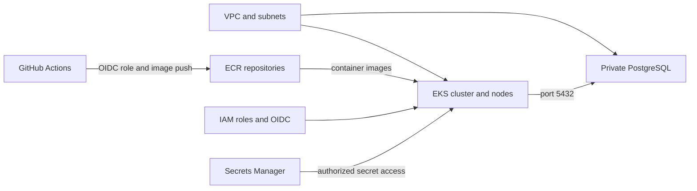

# Development Environment (envs/dev) — Terraform Architecture Overview

This directory is the environment layer that wires together all infrastructure modules for the `dev` environment.

It is the orchestration layer of the repository. It does not define AWS resources directly in large numbers; instead, it calls smaller reusable modules such as:

- `vpc`
- `eks`
- `rds`
- `ecr`
- `iam`
- `secrets_manager`

This is a strong Terraform pattern: environment folders configure values, while module folders encapsulate resource definitions.

---

## 1) Purpose of the environment folder

The `envs/dev` directory is where the project chooses:

- the environment name (`dev`)
- the AWS region (`us-east-1`)
- the project name (`pharma`)
- the network CIDRs
- the database credentials
- the GitHub organization used for OIDC

It acts like a configuration blueprint for the `dev` deployment.

---

## 2) Files in this directory

The relevant files are:

- [main.tf](./main.tf)
- [variables.tf](./variables.tf)
- [providers.tf](./providers.tf)
- [backend.tf](./backend.tf)
- [output.tf](./output.tf)

---

## 3) Core configuration: main.tf

This is the main orchestration file.

```hcl
locals {
  project = "pharma"
  env     = "dev"
  region  = "us-east-1"
}

data "aws_caller_identity" "current" {}

module "vpc" {
  source = "../../modules/vpc"

  project               = local.project
  env                   = local.env
  region                = local.region
  vpc_cidr              = "10.0.0.0/16"
  public_subnet_cidrs   = ["10.0.1.0/24", "10.0.2.0/24"]
  private_subnet_cidrs  = ["10.0.3.0/24", "10.0.4.0/24"]
  database_subnet_cidrs = ["10.0.5.0/24", "10.0.6.0/24"]
}
```

### What this does

- defines project-wide values used by all modules
- creates the VPC using the custom VPC module
- assigns specific subnet ranges for public, private, and database subnets

This is the first building block of the entire platform.

### Why the values matter

- `10.0.0.0/16` = VPC CIDR
- `10.0.1.0/24` and `10.0.2.0/24` = public networking
- `10.0.3.0/24` and `10.0.4.0/24` = private Kubernetes networking
- `10.0.5.0/24` and `10.0.6.0/24` = private database networking

This cleanly separates the network to improve security and reduce exposure.

---

### EKS module call

```hcl
module "eks" {
  source = "../../modules/eks"

  project            = local.project
  env                = local.env
  vpc_id             = module.vpc.vpc_id
  subnet_ids         = module.vpc.private_subnets
  kubernetes_version = "1.33"
  instance_types     = ["t3.small"]
  min_size           = 1
  max_size           = 5
  desired_size       = 4
}
```

### Purpose

This creates the EKS cluster inside the VPC private subnets.

Important details:

- `vpc_id` comes from the VPC module output
- `subnet_ids` are the private subnets, which is good for worker isolation
- `instance_types = ["t3.small"]` defines the EC2 VM size for the node group
- `desired_size = 4` means the cluster starts with 4 workers

This is the application runtime environment for the microservices.

---

### RDS module call

```hcl
module "rds" {
  source = "../../modules/rds"

  project                    = local.project
  env                        = local.env
  username                   = "pharmaadmin"
  password                   = var.db_password
  vpc_id                     = module.vpc.vpc_id
  db_subnet_group_name       = module.vpc.database_subnet_group_name
  eks_node_security_group_id = module.eks.node_security_group_id
}
```

### Purpose

This creates PostgreSQL inside the private database subnets and restricts access to the EKS nodes only.

This is extremely important because:

- the database is not public
- only the app layer can reach it
- the network boundary is controlled by security groups

---

### ECR module call

```hcl
module "ecr" {
  source = "../../modules/ecr"

  project = local.project
  env     = local.env
  repositories = [
    "api-gateway",
    "auth-service",
    "drug-catalog-service",
    "inventory-service",
    "manufacturing-service",
    "notification-service",
    "pharma-ui",
    "supplier-service",
    "qc-service",
  ]
}
```

### Purpose

This creates ECR repositories so each service can store Docker images.

Typical pattern in this project:

- UI and each backend service gets its own ECR repo
- developers or CI pipelines push new images
- Kubernetes pulls those images during deployment

---

### IAM module call

```hcl
module "iam" {
  source = "../../modules/iam"

  project           = local.project
  env               = local.env
  oidc_provider_arn = module.eks.oidc_provider_arn
  oidc_provider_url = module.eks.cluster_oidc_issuer_url
  aws_account_id    = data.aws_caller_identity.current.account_id
  github_org        = var.github_org
}
```

### Purpose

This creates IAM roles for:

- IRSA for External Secrets Operator
- IRSA for ArgoCD
- IRSA for AWS Load Balancer Controller
- GitHub Actions OIDC federation

This module is crucial because it avoids long-lived AWS credentials and gives Kubernetes and GitHub CI limited permissions.

---

### Secrets Manager module call

```hcl
module "secrets_manager" {
  source = "../../modules/secrets-manager"

  project     = local.project
  env         = local.env
  db_username = "pharmaadmin"
  db_password = var.db_password
  db_host     = module.rds.db_instance_address
  jwt_secret  = var.jwt_secret
}
```

### Purpose

This stores application secrets securely in AWS Secrets Manager:

- database username/password/host
- JWT signing secret

This keeps secrets out of Terraform variables in runtime-managed configuration and allows Kubernetes workloads to read them through the External Secrets Operator.

---

## 4) Variables file

The [variables.tf](./variables.tf) file declares values that are not hardcoded in the environment:

```hcl
variable "db_password" {
  description = "Master password for the RDS PostgreSQL database"
  type        = string
  sensitive   = true
}

variable "jwt_secret" {
  description = "JWT signing secret for the application"
  type        = string
  sensitive   = true
}

variable "github_org" {
  description = "GitHub username or organization that owns frontend and backend"
  type        = string
  default     = "zenpharma"
}
```

### Purpose

These are environment-sensitive values.

- `db_password` is used for database access
- `jwt_secret` is used by the application to sign tokens
- `github_org` is used to restrict GitHub OIDC trust to the intended repos

Because they are marked `sensitive`, Terraform avoids printing them in logs.

---

## 5) Providers configuration

The [providers.tf](./providers.tf) file sets up Terraform providers and AWS defaults.

```hcl
terraform {
  required_version = ">= 1.11.0"

  required_providers {
    aws = {
      source  = "hashicorp/aws"
      version = "~> 6.0"
    }
    kubernetes = {
      source  = "hashicorp/kubernetes"
      version = "~> 3.0"
    }
    tls = {
      source  = "hashicorp/tls"
      version = "~> 4.0"
    }
  }
}
```

### Explanation

This block tells Terraform which providers are required.

- AWS provider manages EC2, VPC, EKS, IAM, ECR, RDS
- Kubernetes provider configures access to the cluster
- TLS provider is sometimes used when creating certificates or trust relationships

Then:

```hcl
provider "aws" {
  region = "us-east-1"

  default_tags {
    tags = {
      Project   = "pharma"
      Env       = "dev"
      ManagedBy = "terraform"
    }
  }
}
```

This configures the AWS provider in the target region and applies standard tags to all created AWS resources.

For Kubernetes access:

```hcl
provider "kubernetes" {
  host                   = module.eks.cluster_endpoint
  cluster_ca_certificate = base64decode(module.eks.cluster_certificate_authority_data)

  exec {
    api_version = "client.authentication.k8s.io/v1beta1"
    command     = "aws"
    args        = ["eks", "get-token", "--cluster-name", module.eks.cluster_name]
  }
}
```

This lets Terraform talk to the EKS cluster after it is created. It uses the cluster endpoint and temporary AWS credentials to authenticate.

---

## 6) Remote state backend

The [backend.tf](./backend.tf) file defines the Terraform backend.

```hcl
terraform {
  backend "s3" {
    bucket       = "zen-pharma-terraform-state-deepakparameswar"
    key          = "envs/dev/terraform.tfstate"
    region       = "us-east-1"
    encrypt      = true
    use_lockfile = true
  }
}
```

### Purpose

Terraform state is stored remotely in S3 instead of locally.

This is best practice because it allows:

- team sharing
- state locking
- safer deployments
- auditability for infrastructure changes

`key = "envs/dev/terraform.tfstate"` keeps the environment state separate from QA or prod state.

`use_lockfile = true` enables locking to prevent concurrent edits to the same state.

---

## 7) Output values

The [output.tf](./output.tf) file exposes important values after deployment:

```hcl
output "rds_endpoint" {
  description = "RDS instance endpoint"
  value       = module.rds.db_instance_endpoint
}

output "eks_cluster_name" {
  description = "EKS cluster name"
  value       = module.eks.cluster_name
}
```

### Purpose

These outputs help other tools or scripts discover connectivity details, such as:

- which database hostname to use
- which cluster name to target for kubectl operations

This is useful for CI/CD, application configuration, and debugging.

---

## 8) How the environment fits together

The complete chain looks like this:

```text
envs/dev/
  -> local values
  -> VPC module
  -> EKS module
  -> RDS module
  -> ECR module
  -> IAM module
  -> Secrets Manager module
```

This is the full deployment flow:

1. Create network foundation
2. Create compute runtime (EKS)
3. Create private database (RDS)
4. Create container repositories (ECR)
5. Create IAM roles and access trust
6. Store secrets securely
7. Deploy application workloads with Kubernetes and CI/CD

---

## 9) Real-world scenario for this environment

Imagine the `dev` environment is used by the engineering team to validate the ZenPharma platform before production release.

In that environment:

- the team deploys the app to EKS
- the application connects to the private PostgreSQL database
- secrets are read from AWS Secrets Manager
- GitHub Actions builds and pushes new images to ECR
- Kubernetes uses IRSA roles instead of static AWS keys

This `dev` environment is a secure testing ground before releasing into production infrastructure.

---

## 10) Summary

The `envs/dev` folder is where the project chooses the actual system shape and wiring.

It is not a random collection of Terraform files — it is the configuration assembly point for the entire AWS platform.

It coordinates all major layers:

- networking
- compute
- data
- images
- identity
- secrets

Without this environment layer, the modules would exist but not be deployed as an application platform.

This is the layer that turns reusable Terraform modules into a functioning environment.

---

## Key technical terms explained

### Module
A Terraform module is a reusable, self-contained group of infrastructure resources. In this repo, `vpc`, `eks`, `rds`, `iam`, `ecr`, and `secrets-manager` are all modules.

### Module input and output
A module takes inputs (variables) and returns outputs. The environment folder passes values into modules, then uses the outputs from one module as inputs to another. For example, the VPC output `vpc_id` is passed to the EKS and RDS modules.

### Provider
A provider is a Terraform plugin that knows how to manage a specific platform or service. `aws` manages AWS, `kubernetes` manages the EKS cluster, and `tls` handles certificate-related resources.

### Backend
A backend stores Terraform state remotely. In this repo, the state is kept in an S3 bucket so the team shares one consistent view of the infrastructure.

### State file
The Terraform state file keeps track of resources already created. It is required to know what infrastructure exists and to plan future changes safely.

### Subnet
A subnet is a part of the VPC used to separate workloads by purpose. This environment has public, private, and database subnets.

### CIDR
CIDR is a notation that defines an IP range. For example, `10.0.0.0/16` describes a large address range inside the VPC.

### Security group
A security group is a firewall attached to AWS resources. It defines which ports and sources can communicate with a resource.

### OIDC
OIDC stands for OpenID Connect. It allows external systems like GitHub Actions or Kubernetes service accounts to authenticate with AWS without storing long-term AWS access keys.

### IRSA
IAM Roles for Service Accounts (IRSA) lets a Kubernetes pod assume an AWS IAM role through a service account. This is used here for secrets access and load balancer management.

### Output value
An output is a value Terraform exposes after resource creation so other parts of the configuration or automation can use it.

### Sensitive variable
A sensitive variable is a value hidden from logs and output. This includes database passwords and JWT secret values.

---

## Verify the dev environment in the AWS Console

After the Terraform workflow completes successfully, select **US East (N. Virginia) / `us-east-1`** in the AWS Console and verify the deployed resources. Resource IDs and some generated names are account-specific, so use the Terraform outputs and resource tags (`Project=pharma`, `Env=dev`) to identify them.



### Environment-level console checklist

| Environment configuration | AWS Console location | What to verify |
|---|---|---|
| Region `us-east-1` and shared tags | Check the region selector, then open the relevant service pages and filter by `Project=pharma`, `Env=dev` tags | Confirm you are inspecting the intended account and dev resources. |
| VPC/EKS/RDS/ECR/IAM/Secrets Manager module calls | Open each service listed below | Verify the resources exist and the links between them match this guide and the module documentation. |
| `backend.tf` remote state | **S3** → **Buckets** → configured Terraform state bucket → `envs/dev/` | Confirm the dev state object exists. Do not edit or delete state objects in the console; state is Terraform's record of managed resources. |
| Sensitive variables | Do not inspect or copy secret values into logs or screenshots | Verify secret metadata and access configuration without exposing passwords or JWT signing material. |

Use the dedicated verification sections in the module guides for exact checks:

- [VPC console checks](../../modules/vpc/README.md#verify-the-vpc-in-the-aws-console)
- [EKS console checks](../../modules/eks/README.md#verify-eks-in-the-aws-console)
- [RDS console checks](../../modules/rds/README.md#verify-rds-in-the-aws-console)
- [ECR console checks](../../modules/ecr/README.md#verify-ecr-in-the-aws-console)
- [IAM console checks](../../modules/iam/README.md#verify-iam-in-the-aws-console)
- [Secrets Manager console checks](../../modules/secrets-manager/README.md#verify-secrets-manager-in-the-aws-console)

The console shows the current deployed state, while Terraform code and state describe what Terraform manages. Avoid manual console edits to Terraform-managed resources: they can create drift and may be overwritten by a later apply.
