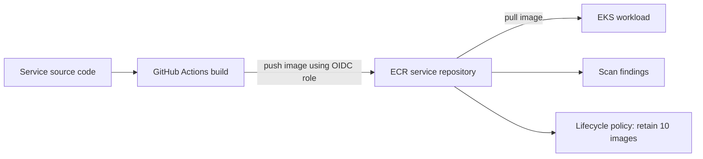

# ECR Module

This module creates Amazon Elastic Container Registry (ECR) repositories for the containers used by the ZenPharma platform.

ECR is where Docker images are stored before being deployed to Kubernetes.

---

## 1) Why ECR is needed

Each service in the platform needs container images. For example:

- frontend UI
- auth service
- inventory service
- supplier service
- api-gateway
- notification service

ECR provides:

- private image storage
- integration with AWS IAM and Kubernetes
- image scanning
- lifecycle cleanup for older images

---

## 2) Files in this module

- [main.tf](./main.tf)
- [variables.tf](./variables.tf)
- [ouputs.tf](./ouputs.tf)

---

## 3) Input variables

The module accepts a list of repository names:

```hcl
variable "project" {
  description = "Project name"
  type        = string
}

variable "env" {
  description = "Environment name (dev, qa, prod)"
  type        = string
}

variable "repositories" {
  description = "List of ECR repository names to create"
  type        = list(string)
}
```

### Purpose

This lets the environment decide which services should have container registries.

Example list from `envs/dev/main.tf`:

```hcl
repositories = [
  "api-gateway",
  "auth-service",
  "drug-catalog-service",
  "inventory-service",
  "manufacturing-service",
  "notification-service",
  "pharma-ui",
  "supplier-service",
  "qc-service",
]
```

---

## 4) Main resource: create repositories dynamically

The core code in [main.tf](./main.tf):

```hcl
resource "aws_ecr_repository" "main" {
  for_each = toset(var.repositories)

  name                 = each.value
  image_tag_mutability = "MUTABLE"

  image_scanning_configuration {
    scan_on_push = true
  }

  tags = {
    Name    = "${var.project}-${each.value}"
    Env     = var.env
    Project = var.project
  }
}
```

### Explanation

`for_each = toset(var.repositories)` means Terraform creates one repository per name in the list.

This is a clean pattern for multi-service architectures.

#### `image_tag_mutability = "MUTABLE"`

This allows tags such as `latest`, `dev`, or build numbers to be overwritten when new images are pushed.

#### `scan_on_push = true`

This enables automatic vulnerability scanning whenever a new image is pushed to the repository.

This is especially useful for security review and compliance.

#### Tags

The repository gets metadata like:

- `Project = pharma`
- `Env = dev`
- `Name = pharma-api-gateway`

---

## 5) Lifecycle policy

The second resource is an ECR lifecycle rule:

```hcl
resource "aws_ecr_lifecycle_policy" "main" {
  for_each   = toset(var.repositories)
  repository = aws_ecr_repository.main[each.key].name

  policy = jsonencode({
    rules = [
      {
        rulePriority = 1
        description  = "Keep last 10 images"
        selection = {
          tagStatus   = "any"
          countType   = "imageCountMoreThan"
          countNumber = 10
        }
        action = {
          type = "expire"
        }
      }
    ]
  })
}
```

### Purpose

This policy keeps the last 10 images and deletes older ones automatically.

This prevents the registry from growing forever and keeps storage costs under control.

---

## 6) Output value

The [ouputs.tf](./ouputs.tf) file exposes a repository URL map:

```hcl
output "repository_urls" {
  description = "Map of repository name to repository URL"
  value       = { for name, repo in aws_ecr_repository.main : name => repo.repository_url }
}
```

### Why it matters

This output allows other modules or pipelines to know the exact repo URL for each service.

For example:

- `api-gateway` repo URL
- `pharma-ui` repo URL
- `auth-service` repo URL

This is used by CI/CD pipelines to push images to the right registry.

---

## 7) Real-world example

When a developer pushes code to the frontend repository, GitHub Actions can:

1. build the Docker image
2. tag it with the commit SHA
3. push it to ECR
4. update Kubernetes manifests or deployment values
5. deploy the new version to EKS

This module provides the registry layer behind that workflow.

---

## 8) Summary

This module is responsible for:

- creating ECR repositories for every app service
- enabling image scanning on push
- applying lifecycle policies to control storage costs
- exposing repo URLs to the rest of the platform

It is the image storage foundation for the application release process.

---

## Key technical terms explained

### ECR
Amazon Elastic Container Registry (ECR) is a managed container image repository in AWS. It is the place where Docker images are stored and retrieved.

### Container image
A container image is a packaged application and its dependencies. It allows the same application to run consistently across environments.

### Repository
A repository is a storage container for container images. In this project, each service gets its own repository.

### Image tag
An image tag is a label like `latest`, `v1.0.0`, or a Git commit SHA. It helps identify a specific image version.

### Image scanning
Image scanning checks a container image for known vulnerabilities. This project enables scanning on push to improve security.

### Lifecycle policy
A lifecycle policy automatically deletes older images once they exceed a defined limit. In this project, the policy keeps the last 10 images and removes the rest.

### Registry URL
The repository URL is the address used by CI/CD pipelines to push or pull images. It is usually in the format `aws_account_id.dkr.ecr.region.amazonaws.com/repository-name`.

### Immutable vs mutable tags
Mutable tags can be overwritten; immutable tags cannot. This project uses mutable tags, which makes updates easier in a dev workflow.

### Why ECR matters in this repo
All services in the platform build container images and push them to ECR, which then provides the deployment source for the EKS cluster.

---

## Verify ECR in the AWS Console

Select **US East (N. Virginia) / `us-east-1`**, then open **Elastic Container Registry (ECR)** → **Private registry** → **Repositories**.



| Terraform configuration | AWS Console location | What to verify |
|---|---|---|
| `repositories` input and `for_each` | ECR → **Repositories** | The configured repositories exist, including `api-gateway`, `auth-service`, `drug-catalog-service`, `inventory-service`, `manufacturing-service`, `notification-service`, `pharma-ui`, `supplier-service`, and `qc-service`. |
| `image_tag_mutability = "MUTABLE"` | Open a repository → **Repository details** | Image tag mutability is **Mutable**. A mutable tag can be moved to a newer image when pushed again. |
| `scan_on_push = true` | Open a repository → **Image scanning** or **Repository details** | Scan on push is enabled. After an image has been pushed/scanned, inspect its image details for findings; an empty findings list does not mean the image contains no unknown vulnerabilities. |
| `aws_ecr_lifecycle_policy.main` | Open a repository → **Lifecycle policy** | The policy expires images once the repository has more than 10 images, according to the configured `tagStatus = any` selection. |
| `repository_urls` output | Open a repository → **URI** | The URI matches the Terraform output map and is the registry/repository path used by CI/CD. |
| Repository tags | Repository → **Tags** | Confirm project and environment metadata (`Project=pharma`, `Env=dev`) where tags are applied. |

The lifecycle policy is asynchronous: do not expect older images to disappear immediately when a push first crosses the limit. Before changing or deleting repositories, check whether active EKS deployments still refer to their images.
