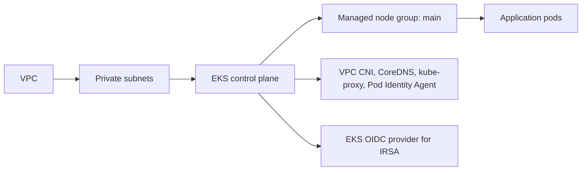

# EKS Module

This module creates the Kubernetes cluster for the ZenPharma platform.

The module is a wrapper around the official AWS Terraform EKS module:

```hcl
module "eks" {
  source  = "terraform-aws-modules/eks/aws"
  version = "~> 21.0"
}
```

This means the repo uses a well-tested, community-maintained EKS implementation rather than writing low-level AWS resources manually.

---

## 1) Role of the EKS module

Amazon EKS is the managed Kubernetes service used to run the application containers.

In this project, the EKS cluster is the main runtime environment for the microservices.

It provides:

- a Kubernetes control plane
- managed worker nodes
- automatic integration with VPC networking
- IAM roles for service accounts (IRSA)
- cluster addon support such as VPC CNI, CoreDNS, and kube-proxy

---

## 2) Files in this module

- [main.tf](./main.tf)
- [variables.tf](./variables.tf)
- [outputs.tf](./outputs.tf)

---

## 3) Input variables

The [variables.tf](./variables.tf) file defines the cluster parameters:

```hcl
variable "project" {
  description = "Project name"
  type        = string
}

variable "env" {
  description = "Environment name (dev, qa, prod)"
  type        = string
}

variable "vpc_id" {
  description = "VPC ID for the EKS cluster"
  type        = string
}

variable "subnet_ids" {
  description = "Subnet IDs for EKS nodes"
  type        = list(string)
}

variable "kubernetes_version" {
  description = "Kubernetes version for the EKS cluster"
  type        = string
  default     = "1.33"
}

variable "instance_types" {
  description = "EC2 instance types for the node group"
  type        = list(string)
  default     = ["t3.medium"]
}

variable "desired_size" {
  description = "Desired number of worker nodes"
  type        = number
  default     = 2
}

variable "min_size" {
  description = "Minimum number of worker nodes"
  type        = number
  default     = 1
}

variable "max_size" {
  description = "Maximum number of worker nodes"
  type        = number
  default     = 3
}
```

### Purpose of these values

- `project` and `env` add naming and tags
- `vpc_id` places the cluster in the correct VPC
- `subnet_ids` selects the private worker subnets
- `kubernetes_version` pins the cluster version
- `instance_types` defines which EC2 instance sizes are used for workers
- `desired_size/min_size/max_size` control autoscaling behavior

---

## 4) Main EKS resource block

The key section of [main.tf](./main.tf) is:

```hcl
module "eks" {
  source  = "terraform-aws-modules/eks/aws"
  version = "~> 21.0"

  name               = "${var.project}-${var.env}-cluster"
  kubernetes_version = var.kubernetes_version

  vpc_id     = var.vpc_id
  subnet_ids = var.subnet_ids

  endpoint_private_access = true
  endpoint_public_access  = true

  enable_irsa                              = true
  enable_cluster_creator_admin_permissions = true

  addons = {
    vpc-cni = {
      most_recent    = true
      before_compute = true
    }
    kube-proxy             = { most_recent = true }
    coredns                = { most_recent = true }
    eks-pod-identity-agent = { most_recent = true }
  }

  eks_managed_node_groups = {
    main = {
      instance_types = var.instance_types
      min_size       = var.min_size
      max_size       = var.max_size
      desired_size   = var.desired_size
    }
  }

  tags = {
    Project = var.project
    Env     = var.env
  }
}
```

### Explanation of each block

#### Cluster name

```hcl
name = "${var.project}-${var.env}-cluster"
```

This names the cluster as something like:

- `pharma-dev-cluster`

This is used later for kubectl, AWS CLI, and OIDC trust configuration.

#### VPC placement

```hcl
vpc_id     = var.vpc_id
subnet_ids = var.subnet_ids
```

This ensures the cluster is created inside the project VPC and deployed to internal private subnets.

#### Public and private access

```hcl
endpoint_private_access = true
endpoint_public_access  = true
```

This allows the Kubernetes API to be accessible both inside the VPC and to authorized clients externally. This is useful for cluster administration and automation while still using VPC-based networking for workloads.

#### IRSA

```hcl
enable_irsa = true
```

This is a major feature. IRSA enables workloads in Kubernetes to assume AWS IAM roles directly via service accounts.

This is used for:

- secrets access
- ArgoCD access
- AWS Load Balancer Controller access

This is more secure than storing long-lived AWS credentials in pods.

#### Cluster creator permissions

```hcl
enable_cluster_creator_admin_permissions = true
```

This grants the user or role that created the cluster admin-level Kubernetes access so cluster setup can happen smoothly.

#### Addons

```hcl
addons = {
  vpc-cni = {
    most_recent    = true
    before_compute = true
  }
  kube-proxy             = { most_recent = true }
  coredns                = { most_recent = true }
  eks-pod-identity-agent = { most_recent = true }
}
```

These are core EKS add-ons:

- `vpc-cni`: enables pod networking inside the VPC
- `kube-proxy`: maintains network rules for nodes and pods
- `coredns`: provides cluster DNS for service discovery
- `eks-pod-identity-agent`: supports pod identity for AWS access without classic IAM roles on EC2 instances

#### Managed node group

```hcl
eks_managed_node_groups = {
  main = {
    instance_types = var.instance_types
    min_size       = var.min_size
    max_size       = var.max_size
    desired_size   = var.desired_size
  }
}
```

This creates the group of EC2 worker nodes that run application pods.

- `instance_types` defines compute capacity
- `min_size` prevents going below the minimum
- `max_size` sets autoscaling ceiling
- `desired_size` ensures the cluster starts with a fixed number of nodes

---

## 5) Output values

The [outputs.tf](./outputs.tf) file exposes data required by other modules:

```hcl
output "cluster_name" {
  description = "Name of the EKS cluster"
  value       = module.eks.cluster_name
}

output "cluster_endpoint" {
  description = "Endpoint for the EKS cluster API server"
  value       = module.eks.cluster_endpoint
}

output "cluster_certificate_authority_data" {
  description = "Base64 encoded certificate data for the cluster"
  value       = module.eks.cluster_certificate_authority_data
}

output "oidc_provider_arn" {
  description = "ARN of the OIDC Provider for IRSA"
  value       = module.eks.oidc_provider_arn
}

output "cluster_oidc_issuer_url" {
  description = "URL of the OIDC Provider for IRSA"
  value       = module.eks.cluster_oidc_issuer_url
}

output "node_security_group_id" {
  description = "Security group ID of the EKS node group"
  value       = module.eks.node_security_group_id
}

output "cluster_security_group_id" {
  description = "Security group ID of the EKS cluster"
  value       = module.eks.cluster_security_group_id
}
```

### Why outputs matter

Other modules depend on these values:

- `iam` needs the OIDC provider URL and ARN
- `providers.tf` in `envs/dev` uses the cluster endpoint and CA certificate
- security groups used by RDS need the node security group ID

Without these outputs, the rest of the infrastructure cannot securely connect to EKS.

---

## 6) Why this module is essential in the project

This EKS module sits in the middle of the stack:

- it depends on the VPC network
- it supports the application services
- it holds the runtime environment
- it enables IAM and security integrations for other modules

In real life, this is where the entire application runs.

A typical platform flow is:

1. Build container image in ECR
2. Deploy app manifest to EKS
3. EKS schedules pods onto worker nodes
4. Pods access secrets via IRSA
5. Pods talk to RDS or other AWS services using IAM roles

---

## 7) Real-world example

Imagine the `auth-service` microservice needs to read a JWT secret and connect to PostgreSQL.

The flow is:

- the application runs on EKS worker nodes
- the pod uses a Kubernetes service account
- the service account is associated with an IAM role through IRSA
- the application reads the secret from AWS Secrets Manager
- the app queries RDS using the network and IAM boundaries

This would not be possible without the EKS cluster and OIDC integration created by this module.

---

## 8) Summary

This module is the compute foundation of the platform.

It manages:

- Kubernetes cluster creation
- managed worker nodes
- networking and autoscaling
- addons for service discovery and networking
- IRSA support for secure AWS access

In short: this is where the application actually runs.

---

## Key technical terms explained

### Kubernetes cluster
A Kubernetes cluster is a set of nodes that run containerized workloads. In this project, EKS is the managed AWS Kubernetes cluster that hosts the Pharma application services.

### Node group
A node group is a group of EC2 instances that run Kubernetes workloads. The cluster uses an EKS managed node group named `main`.

### Subnet ID
A subnet ID is the unique AWS identifier for a subnet. The EKS cluster uses the private subnet IDs so that nodes are not directly exposed to the internet.

### Endpoint
An endpoint is the address used to connect to a service. For EKS, the cluster endpoint is the API server address used by kubectl and the Kubernetes Terraform provider.

### Addon
An addon is a managed component that adds capabilities to the cluster, such as networking, DNS, and pod identity support.

### VPC CNI
VPC CNI is the networking plugin that enables pods to receive IP addresses from the VPC network so they can communicate within AWS.

### CoreDNS
CoreDNS provides DNS service discovery inside the cluster so services can resolve each other by name.

### IRSA
IAM Roles for Service Accounts is the AWS feature that lets Kubernetes service accounts assume AWS IAM roles securely without static credentials.

### OIDC provider
An OIDC provider allows AWS to trust external identity systems. In EKS, this is how service accounts can exchange identity for AWS access.

### Autoscaling
Autoscaling means the cluster can increase or reduce the number of worker nodes depending on workload demand. This is controlled by `min_size`, `max_size`, and `desired_size`.

### Kubernetes service account

A service account is an identity used by workloads running in Kubernetes. It is often linked to an IAM role using IRSA.

---

## Verify EKS in the AWS Console

Select **US East (N. Virginia) / `us-east-1`**. The dev cluster name is `pharma-dev-cluster`.



| Terraform setting/output | AWS Console location | What to verify |
|---|---|---|
| `name = pharma-dev-cluster`, `kubernetes_version` | **EKS** → **Clusters** → `pharma-dev-cluster` → **Overview** | Cluster status is **Active** and Kubernetes version matches the environment configuration (`1.33`). |
| `vpc_id`, `subnet_ids` | Cluster → **Networking** | VPC matches `pharma-dev-vpc`; subnet IDs correspond to the private EKS subnets (`10.0.3.0/24`, `10.0.4.0/24`). |
| `endpoint_private_access = true`, `endpoint_public_access = true` | Cluster → **Networking** → **Cluster endpoint access** | Both access modes are enabled as configured. Public endpoint access is still subject to the configured endpoint access rules; do not interpret it as anonymous access. |
| `eks_managed_node_groups.main` and size settings | Cluster → **Compute** → **Node groups** → `main` | Node group is **Active**, instance type is `t3.small` for dev, and desired/min/max capacity matches dev configuration (4/1/5). |
| `addons` map | Cluster → **Add-ons** | Check VPC CNI, kube-proxy, CoreDNS, and EKS Pod Identity Agent are installed and active. The VPC CNI is configured to be installed before compute. |
| `enable_irsa = true` and EKS OIDC outputs | Cluster → **Access** (or **Configuration** → **Authentication**) | An OIDC provider/issuer is associated with the cluster. IAM roles that use it can be checked under **IAM** → **Roles**. |
| Cluster and node security groups (module outputs) | Cluster → **Networking**; follow the security group IDs to **EC2** → **Security Groups** | Confirm the IDs match the outputs Terraform exposes. Review actual ingress/egress rules before making changes. |

For workload-level verification, use the **Resources** tab (if available) or connect with `kubectl` using the cluster name and confirm nodes show **Ready**. The AWS Console cluster status alone does not prove that application pods are healthy.

If node group capacity differs, first account for the current autoscaler/desired capacity and compare with the Terraform values; do not resize the node group manually unless that change is intended to be temporary.
