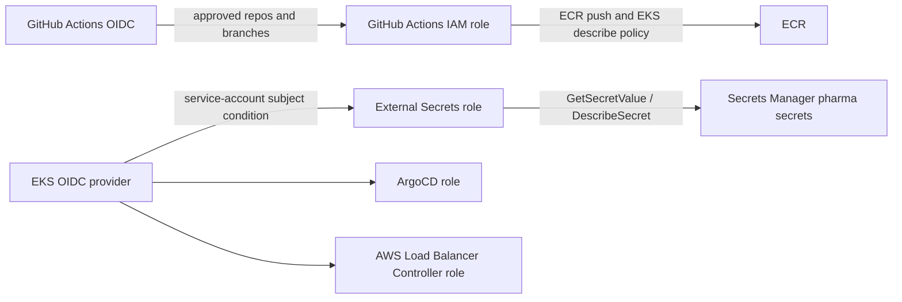

# IAM Module

This module creates the AWS identity and access layer required by the project.

It is one of the most important modules because it connects:

- GitHub Actions
- Kubernetes workloads
- ArgoCD
- External Secrets Operator
- AWS Load Balancer Controller

### How the AWS Load Balancer is created in this project

There is no Terraform module in this repository that directly creates the application's AWS Application Load Balancer (ALB). These parts work together:

1. **EKS provides the Kubernetes cluster and worker nodes.** The EKS infrastructure is defined in the [EKS module](../eks/main.tf).
2. **This IAM module gives the controller permission to manage load balancers in AWS.** It creates the `pharma-<env>-alb-controller-role` role and its policy. The role trusts the EKS service account `kube-system/aws-load-balancer-controller`, so the controller can use temporary AWS credentials instead of stored access keys. See the [controller role and policy](./main.tf).
3. **The prerequisites script installs the AWS Load Balancer Controller into the cluster.** It uses Helm and runs the controller in the Kubernetes `kube-system` namespace. See [scripts/01_install_prerequisites.py](../../scripts/01_install_prerequisites.py).
4. **A Kubernetes `Ingress` asks for an ALB.** The controller watches Ingress resources configured with `ingressClassName: alb`. When it finds one, it uses its IAM role to create and manage the corresponding ALB and related AWS resources. The ALB is therefore created dynamically by the controller, not directly by a Terraform module.

In short: **EKS runs the controller, IAM authorizes it, the setup script installs it, and a Kubernetes Ingress causes it to create an ALB.** The IAM role alone does not create a load balancer; an applicable Ingress must be deployed.

The module uses AWS IAM roles, OIDC trust policies, and service account identity mapping.

---

## 1) Why IAM is needed here

Without IAM, workloads and automation would need static AWS credentials stored in secrets or environment variables. That is risky and not recommended.

This repo uses AWS IAM roles for service accounts (IRSA) and OIDC for GitHub Actions.

That means:

- A pod running under an authorized Kubernetes service account can get temporary AWS credentials. Those credentials let it perform only the AWS actions allowed by its assigned IAM role—for example, the External Secrets Operator can read the secrets it is permitted to access.
- GitHub Actions can deploy infrastructure without static access keys
- AWS resources are accessible in a short-lived, tightly scoped way

In AWS terminology, **“assume a role”** means “temporarily use the permissions of that role.” The pod does not become an IAM role permanently, and it does not receive the role's password; AWS issues temporary credentials after checking the pod's identity.

---

## 2) Files in this module

- [main.tf](./main.tf)
- [variables.tf](./variables.tf)
- [outputs.tf](./outputs.tf)
- [github-actions-oidc.tf](./github-actions-oidc.tf)

---

## 3) Main IAM concepts used

### 3.1 OIDC federation

OIDC lets an external system exchange a token for temporary AWS credentials.

This repo uses:

- GitHub Actions OIDC
- EKS OIDC provider for IRSA

The EKS module exposes the OIDC provider ARN and issuer URL in [modules/eks/outputs.tf](../eks/outputs.tf):

```hcl
output "oidc_provider_arn" {
  description = "ARN of the OIDC Provider for IRSA"
  value       = module.eks.oidc_provider_arn
}

output "cluster_oidc_issuer_url" {
  description = "URL of the OIDC Provider for IRSA"
  value       = module.eks.cluster_oidc_issuer_url
}
```

The environment passes these two outputs into this IAM module in [envs/dev/main.tf](../../envs/dev/main.tf):

```hcl
oidc_provider_arn = module.eks.oidc_provider_arn
oidc_provider_url = module.eks.cluster_oidc_issuer_url
```

The IAM trust policies use the ARN to identify the trusted EKS OIDC provider, and the URL to build conditions that restrict which Kubernetes service account may use each role.

---

## 4) External Secrets Operator (ESO) role

The first important section in [main.tf](./main.tf) is:

```hcl
data "aws_iam_policy_document" "eso_assume_role" {
  statement {
    actions = ["sts:AssumeRoleWithWebIdentity"]
    effect  = "Allow"

    condition {
      test     = "StringEquals"
      variable = "${replace(var.oidc_provider_url, "https://", "")}:sub"
      values   = ["system:serviceaccount:external-secrets:external-secrets"]
    }

    condition {
      test     = "StringEquals"
      variable = "${replace(var.oidc_provider_url, "https://", "")}:aud"
      values   = ["sts.amazonaws.com"]
    }

    principals {
      identifiers = [var.oidc_provider_arn]
      type        = "Federated"
    }
  }
}
```

### How this role connects to the setup scripts

This section of `main.tf` configures **AWS-side permissions and trust**. It does not install ESO or configure Kubernetes by itself. These are separate steps in the project:

1. **Terraform creates the IAM role and its permissions.** The role is created by the `resource "aws_iam_role" "eso_role"` block in [modules/iam/main.tf](./main.tf#L26-L35). Its `name` is built from `"${var.project}-${var.env}-eso-role"`. The dev environment passes `project = "pharma"` and `env = "dev"` through the `module "iam"` block in [envs/dev/main.tf](../../envs/dev/main.tf#L68-L76), so Terraform creates an AWS IAM role named **`pharma-dev-eso-role`**. The `assume_role_policy` connects that role to the EKS OIDC provider and allows the `external-secrets` Kubernetes service account in the `external-secrets` namespace to use it. A separate policy, attached to this role below, allows `secretsmanager:GetSecretValue` and `secretsmanager:DescribeSecret` for secrets under `/pharma/*`.
2. **The prerequisites script installs ESO.** [scripts/01_install_prerequisites.py](../../scripts/01_install_prerequisites.py) installs the ESO controller with Helm in the `external-secrets` namespace. Installing the controller gives the cluster the software, but does not by itself connect it to this IAM role.
3. **The ESO setup script connects the controller to the role.** [scripts/03_setup_external_secrets.py](../../scripts/03_setup_external_secrets.py) builds the role ARN from the AWS account ID and role name, then annotates the `external-secrets` Kubernetes service account with `eks.amazonaws.com/role-arn=<role ARN>`. It restarts the controller so its pods use that service account configuration.
4. **That same setup script tells ESO what to read from AWS.** It creates a `ClusterSecretStore` that selects AWS Secrets Manager, the region, and the `external-secrets` service account. It also creates `ExternalSecret` resources that name the AWS secret paths and map JSON fields into Kubernetes Secrets.

The relationship is:

```text
Terraform IAM role + read policy
        | trusts EKS OIDC identity for the external-secrets service account
        v
scripts/03_setup_external_secrets.py annotates that service account with the role ARN
        |
        v
ESO controller pod uses temporary AWS credentials for that role
        |
        v
ESO reads permitted AWS Secrets Manager values and writes Kubernetes Secrets
```

So, Terraform prepares the AWS role and defines **who may use it** and **what that role may read**. `01_install_prerequisites.py` installs ESO. `03_setup_external_secrets.py` links ESO's Kubernetes service account to the role and configures which AWS secrets ESO should synchronize. If any of these pieces is missing, ESO may be installed but unable to read the AWS secrets.

Then the role is created:

```hcl
resource "aws_iam_role" "eso_role" {
  name               = "${var.project}-${var.env}-eso-role"
  assume_role_policy = data.aws_iam_policy_document.eso_assume_role.json
}
```

And the policy attached to it:

```hcl
resource "aws_iam_policy" "eso_secrets_policy" {
  name        = "${var.project}-${var.env}-eso-secrets-policy"
  description = "Allow External Secrets Operator to read pharma secrets from AWS Secrets Manager"

  policy = jsonencode({
    Version = "2012-10-17"
    Statement = [
      {
        Effect = "Allow"
        Action = [
          "secretsmanager:GetSecretValue",
          "secretsmanager:DescribeSecret"
        ]
        Resource = "arn:aws:secretsmanager:*:${var.aws_account_id}:secret:/pharma/*"
      }
    ]
  })
}
```

### Why this matters

This allows External Secrets Operator to read secret values from AWS Secrets Manager and inject them into the app as Kubernetes secrets.

This is how the project keeps sensitive values such as DB password and JWT secret outside the application manifests.

---

## 5) ArgoCD IRSA role

This section creates a trust policy for ArgoCD:

```hcl
data "aws_iam_policy_document" "argocd_assume_role" {
  statement {
    actions = ["sts:AssumeRoleWithWebIdentity"]
    effect  = "Allow"

    condition {
      test     = "StringEquals"
      variable = "${replace(var.oidc_provider_url, "https://", "")}:sub"
      values   = ["system:serviceaccount:argocd:argocd-application-controller"]
    }

    condition {
      test     = "StringEquals"
      variable = "${replace(var.oidc_provider_url, "https://", "")}:aud"
      values   = ["sts.amazonaws.com"]
    }

    principals {
      identifiers = [var.oidc_provider_arn]
      type        = "Federated"
    }
  }
}
```

### Purpose

This lets ArgoCD's application controller access AWS resources using a Kubernetes service account identity instead of secret-based credentials.

This is used in a GitOps setup where ArgoCD needs to manage resources or read environment-specific configurations.

---

## 6) AWS Load Balancer Controller role

This role is used by the AWS Load Balancer Controller in Kubernetes.

```hcl
data "aws_iam_policy_document" "alb_controller_assume_role" {
  statement {
    actions = ["sts:AssumeRoleWithWebIdentity"]
    effect  = "Allow"

    condition {
      test     = "StringEquals"
      variable = "${replace(var.oidc_provider_url, "https://", "")}:sub"
      values   = ["system:serviceaccount:kube-system:aws-load-balancer-controller"]
    }

    condition {
      test     = "StringEquals"
      variable = "${replace(var.oidc_provider_url, "https://", "")}:aud"
      values   = ["sts.amazonaws.com"]
    }

    principals {
      identifiers = [var.oidc_provider_arn]
      type        = "Federated"
    }
  }
}
```

Then the corresponding AWS IAM policy is created with permissions like:

- `ec2:DescribeSubnets`
- `ec2:DescribeSecurityGroups`
- `elasticloadbalancing:CreateLoadBalancer`
- `elasticloadbalancing:CreateTargetGroup`
- `elasticloadbalancing:CreateListener`
- `elasticloadbalancing:RegisterTargets`

### Purpose

This allows the controller to create and manage AWS ALBs/NLBs that front the application.

Without this role, the Kubernetes ingress or load balancer controller would not be able to manage AWS load balancers.

---

## 7) GitHub Actions OIDC provider

The separate file [github-actions-oidc.tf](./github-actions-oidc.tf) handles CI/CD identity for GitHub Actions.

```hcl
resource "aws_iam_openid_connect_provider" "github_actions" {
  url = "https://token.actions.githubusercontent.com"

  client_id_list = ["sts.amazonaws.com"]

  thumbprint_list = [
    "6938fd4d98bab03faadb97b34396831e3780aea1",
    "1c58a3a8518e8759bf075b76b750d4f2df264fcd",
  ]
}
```

### Purpose

This registers GitHub as a trusted OIDC provider for AWS.

Then the trust policy restricts which repositories and branches are allowed:

```hcl
data "aws_iam_policy_document" "github_actions_assume_role" {
  statement {
    actions = ["sts:AssumeRoleWithWebIdentity"]
    effect  = "Allow"

    principals {
      type        = "Federated"
      identifiers = [aws_iam_openid_connect_provider.github_actions.arn]
    }

    condition {
      test     = "StringEquals"
      variable = "token.actions.githubusercontent.com:aud"
      values   = ["sts.amazonaws.com"]
    }

    condition {
      test     = "StringLike"
      variable = "token.actions.githubusercontent.com:sub"
      values = [
        "repo:${var.github_org}/frontend:ref:refs/heads/main",
        "repo:${var.github_org}/frontend:ref:refs/heads/develop",
        "repo:${var.github_org}/backend:ref:refs/heads/main",
        "repo:${var.github_org}/backend:ref:refs/heads/develop",
      ]
    }
  }
}
```

### Why this is important

This is a security best practice because:

- no long-lived AWS secret is stored in GitHub
- the role is assumed only from approved repos/branches
- the token is short-lived and automatically expires

Then a policy is attached to the role:

```hcl
resource "aws_iam_role" "github_actions_ci" {
  name                 = "${var.project}-${var.env}-github-actions-role"
  assume_role_policy   = data.aws_iam_policy_document.github_actions_assume_role.json
  max_session_duration = 3600
}
```

The permissions include:

- `ecr:GetAuthorizationToken`
- `ecr:PutImage`
- `ecr:BatchGetImage`
- `eks:DescribeCluster`

### Why

This allows GitHub Actions to:

- push built images to ECR
- verify the EKS cluster is available
- deploy or validate the application pipeline

---

## 8) Output values

The [outputs.tf](./outputs.tf) file exposes role ARNs:

```hcl
output "eso_role_arn" {
  description = "ARN of the External Secrets Operator IAM role"
  value       = aws_iam_role.eso_role.arn
}

output "argocd_role_arn" {
  description = "ARN of the ArgoCD IAM role"
  value       = aws_iam_role.argocd_role.arn
}

output "alb_controller_role_arn" {
  description = "ARN of the AWS Load Balancer Controller IAM role"
  value       = aws_iam_role.alb_controller_role.arn
}
```

This lets other automation or Helm values reference the exact role ARN.

---

## 9) Real-world example

Imagine the team wants to deploy new application code.

The workflow is:

1. GitHub Actions builds the Docker image
2. GitHub receives a temporary OIDC token
3. AWS validates it against the OIDC provider
4. GitHub Actions assumes the IAM role and pushes the image to ECR
5. Kubernetes uses IRSA roles to read the secret and manage AWS load balancing

This removes the need for static AWS keys and makes the process secure and auditable.

---

## 10) Summary

This module is the security and access layer for the platform.

It manages:

- OIDC trust for GitHub Actions
- EKS IRSA role trust policies
- Secrets Manager access for external-secrets
- ArgoCD access for GitOps automation
- AWS Load Balancer Controller access for traffic routing

In short: this is the identity foundation that makes the rest of the infrastructure secure.

---

## Key technical terms explained

### IAM role
An IAM role is a set of permissions that can be assumed by a trusted entity, such as a user, service account, or identity provider. Roles are safer than static credentials because they are temporary and scoped.

### Policy
A policy is a JSON document that defines what actions are allowed or denied. This repo uses AWS IAM policies to control who can access ECR, Secrets Manager, EKS, and other AWS services.

### Assume role
Assume role is the action of temporarily taking on an IAM role. This is what Kubernetes and GitHub Actions do through OIDC-based trust relationships.

### OIDC
OpenID Connect is a standard identity protocol. AWS can trust GitHub or an EKS OIDC provider so external workloads can authenticate without static keys.

### Federated identity
Federated identity means AWS trusts an external identity provider. In this project, GitHub and EKS both act as trusted identity providers.

### IRSA
IAM Roles for Service Accounts lets a Kubernetes service account assume an AWS role. This is used for External Secrets Operator, ArgoCD, and the AWS Load Balancer Controller.

### Service account
A Kubernetes service account is an identity assigned to application pods. It is often the thing mapped to an AWS role.

### AWS STS
AWS Security Token Service (STS) issues temporary credentials when a trusted entity assumes a role. This is how OIDC-based access works.

### Role ARN
An ARN is the unique AWS identifier for a role. It is used by systems that need to assume that role.

### Least privilege
Least privilege means granting only the minimum permissions needed for a role. The project follows this by scoping permissions to specific services and paths.

---

## Verify IAM in the AWS Console

Select the intended AWS account and region (`us-east-1` for this dev stack). IAM roles are account-level resources; use the environment/project names and trust-policy details to distinguish them.



| Terraform configuration | AWS Console location | What to verify |
|---|---|---|
| `github-actions-oidc.tf` OIDC provider | **IAM** → **Identity providers** → provider `token.actions.githubusercontent.com` | Provider URL is GitHub Actions and audience/client ID includes `sts.amazonaws.com`. |
| GitHub Actions trust policy | **IAM** → **Roles** → `pharma-dev-github-actions-role` → **Trust relationships** | Principal is the GitHub OIDC provider; audience is `sts.amazonaws.com`; subject conditions restrict access to the configured `zenpharma/frontend` and `zenpharma/backend` `main` and `develop` branches. |
| GitHub Actions permission policy | Role → **Permissions** | The attached policy grants the configured ECR image push/read actions and EKS describe/list access. Verify permissions are limited to what the pipeline needs. |
| EKS OIDC trust policies | **IAM** → **Roles** → `pharma-dev-eso-role`, `pharma-dev-argocd-role`, and `pharma-dev-alb-controller-role` → **Trust relationships** | Each role trusts the EKS OIDC provider and the expected Kubernetes namespace/service account subject (`external-secrets:external-secrets`, `argocd:argocd-application-controller`, or `kube-system:aws-load-balancer-controller`) with audience `sts.amazonaws.com`. |
| ESO Secrets Manager policy | `pharma-dev-eso-role` → **Permissions** → expand attached policy | Allowed actions include `secretsmanager:GetSecretValue` and `secretsmanager:DescribeSecret`, scoped to the configured `/pharma/*` secret path. |
| ALB controller permissions | `pharma-dev-alb-controller-role` → **Permissions** | The load balancer controller policy is attached and contains the EC2/Elastic Load Balancing actions defined in `modules/iam/main.tf`. Review the full policy and scope before changing it. |
| ArgoCD role | `pharma-dev-argocd-role` → **Trust relationships** and **Permissions** | This module creates the role and trust relationship. It does not attach an AWS permissions policy to the ArgoCD role in the inspected Terraform; do not assume it has AWS permissions unless another configuration attaches them. |
| Role tags and ARNs | Each role → **Tags** / role summary | Check project/environment tags and compare role ARNs against module outputs or Kubernetes/CI configuration. |

### Safe verification notes

- Inspect policy JSON and trust relationships; do not use **Switch role** or create long-lived access keys just to check configuration.
- A correct IAM role alone does not prove that a Kubernetes service account is annotated/configured to use it. Verify the corresponding Kubernetes service account configuration in the cluster as a separate step.
- IAM changes can grant broad access. Use Terraform plans and review policy diffs before applying changes.
