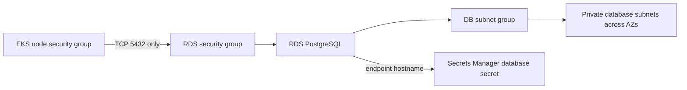

# RDS Module

This module creates the PostgreSQL database used by the ZenPharma application.

The repository uses a managed PostgreSQL service from AWS RDS instead of running a database server on EC2.

The module combines:

- a custom security group resource
- a third-party Terraform RDS module

```hcl
resource "aws_security_group" "rds" {
  ...
}

module "rds" {
  source  = "terraform-aws-modules/rds/aws"
  version = "~> 7.0"
}
```

---

## 1) Purpose of RDS in the architecture

RDS is the database tier of the application.

The application microservices need a durable, private, managed database for data persistence, for example:

- users and authentication data
- product inventory
- supplier data
- manufacturing batch records
- order and transaction records

In AWS, RDS provides:

- managed database hosting
- backups
- scaling options
- improved operational simplicity
- private-access networking when placed in a VPC

---

## 2) Files in this module

- [main.tf](./main.tf)
- [variables.tf](./variables.tf)
- [outputs.tf](./outputs.tf)

---

## 3) Input variables

The complete declarations are in [variables.tf](./variables.tf). A Terraform `variable` is an input (a setting this module receives from its caller). The properties inside each declaration describe that input:

- `description` is a human-readable note about what the input is for. It helps people reading the code and Terraform prompts.
- `type` says what kind of value is allowed. `string` means text, `number` means a number, and `bool` means `true` or `false`. Terraform reports an error if the supplied value has the wrong type.
- `default` is the value Terraform uses when the caller does not provide one. Variables without a `default` are required.
- `sensitive = true` tells Terraform to mask the value in normal terminal output. It does not encrypt or remove the value from Terraform state.

Each input is used by the RDS module as follows:

| Input | Type and default | What it controls / where it is used | Dev configuration |
|---|---|---|---|
| `project` | `string`; required | Project label. Used in the RDS security-group and database names, and in AWS resource tags. | `pharma` (set as a local in [envs/dev/main.tf](../../envs/dev/main.tf)). |
| `env` | `string`; required | Environment label, such as `dev`. Added to resource names and tags so environments can be distinguished. | `dev` (set as a local in `envs/dev/main.tf`). |
| `vpc_id` | `string`; required | Identifies the VPC where the RDS security group is created. In [main.tf](./main.tf), it is assigned to `aws_security_group.rds.vpc_id`. | Passed from `module.vpc.vpc_id`. |
| `db_subnet_group_name` | `string`; required | Tells RDS which database subnets to use, placing the database in the VPC's database network. | Passed from `module.vpc.database_subnet_group_name`. |
| `eks_node_security_group_id` | `string`; required | Identifies the EKS worker-node security group. The RDS security group allows inbound PostgreSQL traffic from this group only. | Passed from `module.eks.node_security_group_id`. |
| `db_name` | `string`; default `"pharmadb"` | Initial database name created inside the PostgreSQL instance; passed to the RDS module as `db_name`. | Not overridden in dev, so `pharmadb` is used. |
| `username` | `string`; required | Initial master/admin username for the database; passed to the RDS module as `username`. | Set to `pharmaadmin` in `envs/dev/main.tf`. |
| `password` | `string`; required; sensitive | Initial master password. Passed as `password_wo` to the RDS module. `sensitive` masks normal Terraform output; it does not keep the value out of Terraform state or other secret storage. | Passed from the root variable `var.db_password`. |
| `password_version` | `number`; default `1` | Version marker passed as `password_wo_version`. Increase it when changing the password so the RDS module knows to apply the new write-only password value. It is not the password itself. | Not overridden in dev, so `1` is used. |
| `instance_class` | `string`; default `"db.t3.micro"` | RDS compute size (CPU/memory class); passed as `instance_class`. Larger classes generally provide more capacity and cost more. | Not overridden in dev, so `db.t3.micro` is used. |
| `allocated_storage` | `number`; default `20` | Initial storage size, in GiB; passed as `allocated_storage`. | Not overridden in dev, so `20` GiB is used. |
| `multi_az` | `bool`; default `false` | Whether RDS should deploy a standby in another Availability Zone for availability/failover; passed as `multi_az`. Multi-AZ can add cost. | Not overridden in dev, so disabled. |
| `skip_final_snapshot` | `bool`; default `true` | Whether AWS should skip creating a final database snapshot when the RDS instance is deleted. `true` means no final snapshot; `false` requests one. | Not overridden in dev, so the final snapshot is skipped. |
| `backup_retention_period` | `number`; default `0` | Number of days RDS retains automated backups; passed as `backup_retention_period`. `0` disables automated backups. | Not overridden in dev, so automated backup retention is disabled. |
| `deletion_protection` | `bool`; default `false` | Whether AWS blocks deletion of the RDS instance; passed as `deletion_protection`. When enabled, protection must be disabled before deleting the instance. | Not overridden in dev, so deletion protection is disabled. |

In the dev caller, the explicitly supplied values are the project/environment, VPC and subnet identifiers, EKS security-group identifier, username, and password. Other settings use the defaults listed above. The VPC and EKS values come from outputs of the other Terraform modules; they are not values you need to look up and type manually.

---

## 4) Security group for RDS

The first part of [main.tf](./main.tf) creates a dedicated RDS security group:

```hcl
resource "aws_security_group" "rds" {
  name        = "${var.project}-${var.env}-rds-sg"
  description = "Security group for RDS PostgreSQL instance"
  vpc_id      = var.vpc_id

  ingress {
    description     = "PostgreSQL from EKS worker nodes"
    from_port       = 5432
    to_port         = 5432
    protocol        = "tcp"
    security_groups = [var.eks_node_security_group_id]
  }

  egress {
    from_port   = 0
    to_port     = 0
    protocol    = "-1"
    cidr_blocks = ["0.0.0.0/0"]
  }

  tags = {
    Name    = "${var.project}-${var.env}-rds-sg"
    Project = var.project
    Env     = var.env
  }
}
```

### What do ingress and egress mean?

Think of this security group as a set of network traffic rules attached to the RDS database:

- **Ingress** means traffic coming **into** the database.
- **Egress** means traffic going **out from** the database.

The direction is always described from the point of view of the resource using this security group (here, the RDS database).

#### Ingress: connections into PostgreSQL

```hcl
ingress {
  description     = "PostgreSQL from EKS worker nodes"
  from_port       = 5432
  to_port         = 5432
  protocol        = "tcp"
  security_groups = [var.eks_node_security_group_id]
}
```

### How are EKS and EC2 worker nodes connected here?

EKS is AWS's managed Kubernetes service. Kubernetes runs application pods, but those pods need computers to run on. In this project, EKS creates **managed worker nodes**, which are EC2 virtual machines. The node security group is a set of AWS network rules associated with those worker machines' network interfaces.

Terraform connects the EKS nodes to the RDS rule in three steps:

1. The EKS module creates a managed node group in [modules/eks/main.tf](../eks/main.tf). For dev, the EKS module is configured in [envs/dev/main.tf](../../envs/dev/main.tf) with the VPC's private subnets and a `t3.small` instance type. AWS runs the Kubernetes worker nodes as EC2 instances in those subnets.
2. The EKS module exposes its node security group ID through [modules/eks/outputs.tf](../eks/outputs.tf) as `node_security_group_id`.
3. In the dev configuration, `eks_node_security_group_id = module.eks.node_security_group_id` passes that ID into the RDS module. The ingress rule below uses it as the allowed source.

The connection can be pictured as:

```text
Application pod
  -> runs on an EKS worker node (an EC2 instance)
  -> worker node has the EKS node security group
  -> RDS ingress allows that security group to connect on TCP 5432
  -> PostgreSQL database
```

This rule allows PostgreSQL connections when the network traffic comes from an interface associated with the EKS node security group and targets TCP port `5432`. `from_port` and `to_port` are both `5432`, so only that port is allowed. The rule refers to the security group ID Terraform passes in; it does not list or manually configure individual EC2 instances. When EKS adds or replaces worker nodes using that security group, the RDS rule continues to allow them.

In this project's configuration, this is how EKS-hosted workloads are allowed to reach the private RDS database. The rule does not allow every machine in the VPC or the public internet. The RDS instance is also configured with `publicly_accessible = false` in the RDS module configuration below.

#### Egress: connections out from PostgreSQL

```hcl
egress {
  from_port   = 0
  to_port     = 0
  protocol    = "-1"
  cidr_blocks = ["0.0.0.0/0"]
}
```

This is a broad outbound rule:

- `protocol = "-1"` means all network protocols.
- `0.0.0.0/0` means any IPv4 destination address—not just AWS addresses or addresses inside this VPC.
- With all protocols selected, `from_port` and `to_port` do not restrict the traffic to particular ports.

In other words, **at the security-group level**, this allows RDS to start outbound IPv4 connections to any destination using any protocol or port. It does not guarantee that those destinations can actually be reached: the subnet's route table, network ACLs, and the destination's own network rules also apply. In this project, database subnets use the private routing setup; where their route table sends internet-bound traffic through the NAT Gateway, outbound internet access may be possible. A NAT Gateway permits responses to outbound connections; it does not make the private RDS instance directly reachable from the internet.

### Does RDS need this rule?

For the normal database flow in this project, the application opens a connection to RDS on PostgreSQL port `5432`, and RDS sends replies on that same connection. AWS security groups are **stateful**, so reply traffic for an allowed inbound connection is automatically permitted. RDS does not need an unrestricted outbound rule just to answer the application's database requests.

**Project-specific answer:** In the Terraform configuration currently in this repository, no RDS feature or application flow is configured that requires the database to start connections to arbitrary destinations. Therefore, this broad egress rule has no identified project-specific need; it is permissive outbound access. It is **not what allows the application to connect**—the ingress rule above does that—and it is not needed to make RDS private. The RDS module sets `publicly_accessible = false`, while ingress allows only the EKS node security group.

Unless the team later enables an RDS feature that needs outbound connections, this rule can be removed or narrowed as a security-hardening change. Before changing it, check the AWS features actually enabled for the database; blocking egress can affect features that need RDS to contact another service. Do not assume that `0.0.0.0/0` means “all of AWS”; it means all IPv4 destinations, subject to the network paths and other rules described above.

---

## 5) RDS instance block

The PostgreSQL database is created via the official AWS RDS Terraform module:

```hcl
module "rds" {
  source  = "terraform-aws-modules/rds/aws"
  version = "~> 7.0"

  identifier = "${var.project}-${var.env}-postgres"

  engine               = "postgres"
  engine_version       = "17.9"
  family               = "postgres17"
  major_engine_version = "17"
  instance_class       = var.instance_class

  allocated_storage = var.allocated_storage
  storage_type      = "gp3"

  db_name                     = var.db_name
  username                    = var.username
  manage_master_user_password = false
  password_wo                 = var.password
  password_wo_version         = var.password_version

  multi_az               = var.multi_az
  db_subnet_group_name   = var.db_subnet_group_name
  vpc_security_group_ids = [aws_security_group.rds.id]

  skip_final_snapshot     = var.skip_final_snapshot
  backup_retention_period = var.backup_retention_period
  storage_encrypted       = true
  deletion_protection     = var.deletion_protection
  publicly_accessible     = false

  create_db_option_group = false

  tags = {
    Name    = "${var.project}-${var.env}-postgres"
    Project = var.project
    Env     = var.env
  }
}
```

### Explanation of each part

#### Database engine and version

```hcl
engine = "postgres"
engine_version = "17.9"
```

This creates a managed PostgreSQL instance.

#### Instance size and storage

```hcl
instance_class = var.instance_class
allocated_storage = var.allocated_storage
storage_type = "gp3"
```

This controls database compute and storage size. In this repo, the default is:

- `db.t3.micro`
- `20 GB`

#### Credentials

```hcl
username = var.username
password_wo = var.password
password_wo_version = var.password_version
```

This sets the database administrator username and password. `password_wo` means write-only value, which is used to keep credential data out of the state in a more controlled way.

#### High availability and backups

```hcl
multi_az = var.multi_az
backup_retention_period = var.backup_retention_period
deletion_protection = var.deletion_protection
```

These are production safety settings. Multi-AZ improves availability, retention protects backups, and deletion protection prevents accidental deletion.

#### Network placement

```hcl
db_subnet_group_name = var.db_subnet_group_name
vpc_security_group_ids = [aws_security_group.rds.id]
publicly_accessible = false
```

This keeps the database in private subnets and prevents public exposure.

#### Encryption

```hcl
storage_encrypted = true
```

This is an important security control. It encrypts the database storage at rest.

---

## 6) Why the database is in private subnets

This is how the repo protects the database from the internet:

- VPC has database subnets
- RDS is attached to that subnet group
- only EKS worker security group is allowed in
- no public access is enabled

This is the standard secure design for application databases.

---

## 7) Outputs

The [outputs.tf](./outputs.tf) file exposes database metadata for the rest of the codebase:

```hcl
output "db_instance_endpoint" {
  description = "Connection endpoint for the RDS instance (hostname:port)"
  value       = module.rds.db_instance_endpoint
}

output "db_instance_address" {
  description = "Hostname of the RDS instance (without port)"
  value       = module.rds.db_instance_address
}

output "db_instance_port" {
  description = "Port of the RDS instance"
  value       = module.rds.db_instance_port
}

output "db_instance_name" {
  description = "Name of the database"
  value       = module.rds.db_instance_name
}
```

These values are used by the Secrets Manager module.

---

## 8) Real-world example

Suppose the `inventory-service` and `drug-catalog-service` store product and stock data.

They need a database that:

- survives restarts
- remains available for app queries
- stores structured relational data
- is protected from direct internet access

RDS provides exactly that.

The workflow is:

1. app runs in EKS
2. pod reaches the RDS endpoint
3. security group allows traffic only from the EKS node security group
4. database processes SQL requests
5. results are returned to app services

This is the pattern used in real production systems.

---

## 9) Summary

This module creates a private, managed PostgreSQL database for the app.

It protects the database by:

- placing it in private VPC subnets
- locking access to only the EKS node security group
- disabling public access
- enabling encryption
- hiding database details through Terraform outputs and AWS Secrets Manager

This is a secure and scalable database design for a cloud-native application.

---

## Key technical terms explained

### RDS
Amazon RDS is a managed relational database service. It handles much of the database operations work for you, such as patching, backups, and infrastructure management.

### PostgreSQL
PostgreSQL is the open-source relational database engine used by this project. It supports structured data, SQL queries, and transactional workloads.

### Security group
A security group is the network firewall that controls who can connect to the RDS instance. In this project, only the EKS node security group is allowed access.

### DB subnet group
A DB subnet group is a logical group of subnets in which the database is placed. It helps AWS choose secure private locations for the database.

### Publicly accessible
A database is considered publicly accessible when it can accept traffic from the internet. This project sets `publicly_accessible = false` to keep the database private.

### Endpoint
The database endpoint is the hostname used by the application to connect to the database. It is similar to the server address of the database instance.

### Multi-AZ
Multi-AZ deployment runs a database in multiple Availability Zones for higher availability. It helps with failover if one zone becomes unavailable.

### Backup retention period
This setting defines how many days AWS keeps automated backups. It is important for restoring data after incidents.

### Encryption at rest
Encryption at rest means the database data is protected while stored on disk. This project enables storage encryption for RDS.

### Port 5432
Port 5432 is the default port for PostgreSQL. The security group allows traffic only on this port from the EKS node security group.

---

## Verify RDS in the AWS Console

Select **US East (N. Virginia) / `us-east-1`** and open the dev database, normally identified by `pharma-dev-postgres`.



| Terraform configuration | AWS Console location | What to verify |
|---|---|---|
| `identifier`, `engine`, `engine_version` | **RDS** → **Databases** → `pharma-dev-postgres` → **Configuration** | Status is available; engine is PostgreSQL and the deployed engine version is the configured version (`17.9`). |
| `instance_class`, `allocated_storage`, `storage_type` | Database → **Configuration** → instance and storage sections | Instance class and allocated storage match the current Terraform variables/defaults; storage type is `gp3`. |
| `db_name`, `username` | Database → **Configuration** | Confirm database name and master username. Do not reveal or copy the password. |
| `db_subnet_group_name`, `publicly_accessible = false` | Database → **Connectivity & security** | Confirm the DB subnet group belongs to the expected VPC, includes private database subnets in multiple AZs, and **Publicly accessible** is **No**. |
| `vpc_security_group_ids` | Database → **Connectivity & security** → VPC security groups; then **EC2** → **Security Groups** | RDS security group ingress should allow TCP `5432` from the EKS node security group, not from `0.0.0.0/0`. |
| `multi_az` | Database → **Configuration** → Availability | Compare the Multi-AZ setting with the environment's configured value. For dev, the module default is `false`. |
| `storage_encrypted`, `backup_retention_period`, `deletion_protection` | Database → **Configuration** → storage, backups, and maintenance | Confirm storage encryption is enabled and inspect backup retention/deletion protection against the configured values. Dev defaults currently use zero backup retention and disable deletion protection. |
| `db_instance_endpoint` and address outputs | Database → **Connectivity & security** | Compare the endpoint and port with Terraform outputs. The endpoint is private connection information; it is not proof that a client is allowed through the security group. |

RDS console checks show placement and settings, but do not test application connectivity. To test that path, check that EKS nodes can resolve the endpoint and that security group rules allow the connection; do not open port `5432` to the public internet as a troubleshooting shortcut.
