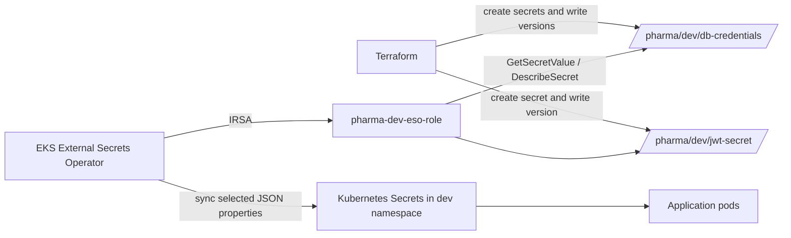

# Secrets Manager Module

This module creates two secrets in AWS Secrets Manager for the selected environment.

It stores environment-specific secrets such as:

- database credentials
- JWT secret

Terraform creates each Secrets Manager secret and writes its initial/current value as a secret version. **External Secrets Operator (ESO)** is a controller that runs inside the EKS Kubernetes cluster. It watches Kubernetes `ExternalSecret` resources, reads the requested secret properties from AWS Secrets Manager using its IAM role, and creates/updates ordinary Kubernetes `Secret` resources. Application pods then consume those Kubernetes Secrets; in this setup, the apps do not call AWS Secrets Manager directly.

ESO is not an AWS service and does not appear as a Secrets Manager feature. This repository installs it into the cluster with Helm in the [prerequisites setup script](../../scripts/01_install_prerequisites.py), in the `external-secrets` namespace. The [ESO setup script](../../scripts/03_setup_external_secrets.py) configures its AWS access and creates the `ClusterSecretStore` and environment-specific `ExternalSecret` resources.

`kubectl` (pronounced “cube control”) is the Kubernetes command-line tool. It is installed on your computer and communicates with the Kubernetes API of whichever cluster your current context selects. It is **not** source code in this repository, and the prerequisites script does not install it: the script checks that the `kubectl` executable is available on your command search path and then runs it. The script also uses the separate `aws` CLI.

To see ESO, first configure `kubectl` for the target EKS cluster. The prerequisites script invokes the **AWS CLI** command `aws eks update-kubeconfig` at [scripts/01_install_prerequisites.py](../../scripts/01_install_prerequisites.py). This is not a command implemented by this repository: the script calls the separately installed `aws` program with the region and cluster name you supplied. The equivalent command in a terminal is:

```powershell
aws eks update-kubeconfig --region <region> --name <cluster-name>
```

For example, replace `<region>` and `<cluster-name>` with your EKS region and cluster name. AWS CLI writes/updates your local Kubernetes connection configuration (usually `%USERPROFILE%\.kube\config` on Windows), allowing `kubectl` to connect to that cluster. Then run:

```powershell
# ESO controller deployment and pods
kubectl get deployment,pods -n external-secrets

# ESO's Kubernetes service account, annotated with its IAM role
kubectl get serviceaccount external-secrets -n external-secrets -o yaml

# AWS provider connection and app-level sync requests
kubectl get clustersecretstore
kubectl get externalsecret -n dev
```

The controller should have available/ready pods. The `ClusterSecretStore` should be ready, and the `ExternalSecret` resources should report `Ready=True`. Use `-n qa` or `-n prod` instead of `-n dev` for another environment. To inspect the IAM role ESO assumes, open AWS Console → **IAM** → **Roles** → `pharma-dev-eso-role`; to inspect the running operator, use Kubernetes (`kubectl`) rather than Secrets Manager in the AWS Console.

---

## 1) Why Secrets Manager is used

Secrets Manager provides encrypted storage and access control, but it does not automatically make every part of the secret lifecycle safe. In this module:

- AWS encrypts secret values at rest. This module does not set a customer-managed KMS key, so AWS uses the Secrets Manager default key unless configured otherwise.
- IAM policies control who can read or manage each secret.
- Terraform needs the supplied values to create the AWS secrets, and it saves a record of what it manages in **Terraform state**. State is Terraform's tracking record and can contain the actual passwords and signing keys. `sensitive = true` tells Terraform to mask those values in its normal human-readable plan/apply output. It only limits what is displayed in that output: it does not stop Terraform from using the values, stop AWS from receiving them, or prevent someone with access to the state or saved plan from reading them. Keep state and saved plans private and encrypted, and limit who can access them and their backups.
- No automatic rotation schedule or rotation Lambda is configured here. Updating an input and applying Terraform changes the secret version; database credential rotation must also be coordinated with RDS and consumers.

AWS Secrets Manager is a managed service designed exactly for this.

This project uses it for:

- RDS credentials
- JWT signing secret

---

## 2) Files in this module

- [main.tf](./main.tf)
- [variables.tf](./variables.tf)
- [outputs.tf](./outputs.tf)

---

## 3) Input variables

The [variables.tf](./variables.tf) file defines the values passed into the module:

```hcl
variable "project" {
  description = "Project name"
  type        = string
}

variable "env" {
  description = "Environment name (dev, qa, prod)"
  type        = string
}

variable "db_username" {
  description = "Database username to store in Secrets Manager"
  type        = string
  sensitive   = true
}

variable "db_password" {
  description = "Database password to store in Secrets Manager"
  type        = string
  sensitive   = true
}

variable "jwt_secret" {
  description = "JWT signing secret to store in Secrets Manager"
  type        = string
  sensitive   = true
}

variable "db_host" {
  description = "RDS endpoint hostname to store alongside credentials"
  type        = string
}
```

### Purpose

The environment's Terraform configuration passes these inputs into the module. In the dev environment, `db_username` is `pharmaadmin`, `db_password` and `jwt_secret` come from Terraform variables, and `db_host` comes from the RDS module output. Keep passwords and signing keys out of source files and command-line arguments; provide them through the project's approved secret input mechanism.

In [variables.tf](./variables.tf), `sensitive = true` is set for `db_username`, `db_password`, and `jwt_secret`. In practical terms, Terraform replaces these values with a hidden marker in its normal plan/apply display instead of printing the actual text. This is a display protection only; it does not block Terraform or AWS from using the values, and it does not stop an authorized person from reading them in Terraform state or a saved plan. For example, someone who can download and inspect the state may be able to see the real values. Protect state and plan files like passwords: keep them private, encrypt their storage, and give access only to people who need it.

---

## 4) Database credentials secret

This is the first main block in [main.tf](./main.tf):

```hcl
resource "aws_secretsmanager_secret" "db_credentials" {
  name                    = "/pharma/${var.env}/db-credentials"
  description             = "Database credentials for the pharma ${var.env} environment"
  recovery_window_in_days = 0

  tags = {
    Name    = "/pharma/${var.env}/db-credentials"
    Env     = var.env
    Project = var.project
  }
}
```

### Purpose

This creates a secret named in the pattern:

- `/pharma/dev/db-credentials`

The secret is stored under an environment-specific name and tagged for management. For `env = "dev"`, its name is `/pharma/dev/db-credentials`. The name is an identifier, not an access-control boundary; IAM policies determine who can read it.

### Where do the values in this code come from?

The values are passed into the secrets module by the environment configuration. For dev, see the `module "secrets_manager"` block in [envs/dev/main.tf](../../envs/dev/main.tf):

| Module input | Where the dev environment gets it |
|---|---|
| `db_username` | Set directly in `envs/dev/main.tf`. |
| `db_password` | Read from the root Terraform variable `var.db_password`, whose value is supplied locally through the Git-ignored `envs/dev/terraform.tfvars` file. |
| `db_host` | Read from the RDS module output `module.rds.db_instance_address`, which is the database endpoint Terraform creates. |

The names such as `var.db_password` are Terraform references, not values typed in this resource block. The input names and types are declared in this module's [variables.tf](./variables.tf); the calling environment passes the actual values to those inputs.

### What does the version resource do?

`aws_secretsmanager_secret` above creates the named secret in AWS (the empty container/record). The following resource supplies the secret's actual contents:

```hcl
resource "aws_secretsmanager_secret_version" "db_credentials" {
  secret_id = aws_secretsmanager_secret.db_credentials.id
  secret_string = jsonencode({
    username = var.db_username
    password = var.db_password
    host     = var.db_host
  })
}
```

Here is what happens in plain language:

1. `var.db_username`, `var.db_password`, and `var.db_host` refer to the values passed in from the dev environment as described above.
2. `jsonencode` packages those three values into one JSON text document, for example with fields named `username`, `password`, and `host`. It does not encrypt the values itself.
3. Terraform sends that JSON text to AWS Secrets Manager as a new version of the secret identified by `secret_id`. AWS Secrets Manager stores the version encrypted.

So this code is where Terraform connects the input values to the AWS secret; the actual values come from the environment configuration and RDS output, not from this snippet.

### Why this is important

The secret content includes:

- database username
- database password
- database host

The Terraform code above defines what AWS stores. The next step is configured separately by ESO. The database `ExternalSecret` definition is built in [scripts/03_setup_external_secrets.py](../../scripts/03_setup_external_secrets.py#L245-L278). This is the specific section to inspect: it tells ESO which AWS secret to read, which JSON fields to take, and what names to use for those values in Kubernetes.

Here is the relevant configuration from that script:

```yaml
kind: ExternalSecret
metadata:
  name: db-credentials
  namespace: <ENV>
spec:
  refreshInterval: 1h
  secretStoreRef:
    name: aws-secrets-manager
    kind: ClusterSecretStore
  target:
    name: db-credentials
    creationPolicy: Owner
  data:
    - secretKey: DB_USERNAME
      remoteRef:
        key: /pharma/<ENV>/db-credentials
        property: username
    - secretKey: DB_PASSWORD
      remoteRef:
        key: /pharma/<ENV>/db-credentials
        property: password
    - secretKey: SPRING_DATASOURCE_USERNAME
      remoteRef:
        key: /pharma/<ENV>/db-credentials
        property: username
    - secretKey: SPRING_DATASOURCE_PASSWORD
      remoteRef:
        key: /pharma/<ENV>/db-credentials
        property: password
    - secretKey: DB_HOST
      remoteRef:
        key: /pharma/<ENV>/db-credentials
        property: host
```

`<ENV>` is replaced by the environment selected when the script runs, such as `dev`. In dev, Terraform creates the AWS secret named `/pharma/dev/db-credentials`.

Read one `data` entry at a time. For example:

```yaml
- secretKey: DB_USERNAME
  remoteRef:
    key: /pharma/dev/db-credentials
    property: username
```

This tells ESO: “Read the AWS secret `/pharma/dev/db-credentials`, take the value of its JSON field called `username`, and put that value under the key `DB_USERNAME` in the Kubernetes Secret.” The exact password, host, and username are not written in this ESO configuration; it contains only the secret name and field names.

In this configuration:

- `remoteRef.key` is the name of the AWS Secrets Manager secret.
- `remoteRef.property` is the name of one field inside that AWS secret's JSON value.
- `secretKey` is the key name ESO writes in Kubernetes.
- `target.name` is the name of the Kubernetes Secret ESO creates or updates. Here it is `db-credentials`.
- `metadata.namespace` is the Kubernetes namespace where that Secret is created. The script substitutes the chosen environment, such as `dev`.
- `secretStoreRef` tells ESO to use the `ClusterSecretStore` named `aws-secrets-manager` to connect to AWS.
- `refreshInterval: 1h` tells ESO to check AWS for changes about once an hour.

The JSON fields are mapped like this:

| Field in AWS JSON (`property`) | Key in Kubernetes Secret (`secretKey`) |
|---|---|
| `username` | `DB_USERNAME` |
| `password` | `DB_PASSWORD` |
| `username` | `SPRING_DATASOURCE_USERNAME` |
| `password` | `SPRING_DATASOURCE_PASSWORD` |
| `host` | `DB_HOST` |

The username and password are each copied to two Kubernetes keys because workloads may expect different key names. The resulting Kubernetes Secret is named `db-credentials` in the selected namespace; it contains those five key/value entries. The `ExternalSecret` is ESO's instruction/configuration, while the Kubernetes `Secret` is the object the application can consume.

The matching JWT mapping is defined immediately below the database definition in the same script: it reads the `secret` property from `/pharma/<ENV>/jwt-secret` and writes it as `JWT_SECRET` in the Kubernetes Secret named `jwt-secret`.

To check that the resources exist and are ready without displaying secret values:

```powershell
kubectl get externalsecret -n dev db-credentials
kubectl get secret -n dev db-credentials
```

To check another environment, replace `dev` with `qa` or `prod`. Avoid printing or decoding the Kubernetes Secret data, because that would reveal the actual credentials.

Terraform creates the secret container separately from its value. The `aws_secretsmanager_secret_version` resource writes a version and, when applied, makes the new version current. This module does not configure a rotation schedule.

---

## 5) JWT secret

The JWT secret is created similarly:

```hcl
resource "aws_secretsmanager_secret" "jwt_secret" {
  name                    = "/pharma/${var.env}/jwt-secret"
  description             = "JWT signing secret for the pharma ${var.env} environment"
  recovery_window_in_days = 0

  tags = {
    Name    = "/pharma/${var.env}/jwt-secret"
    Env     = var.env
    Project = var.project
  }
}

resource "aws_secretsmanager_secret_version" "jwt_secret" {
  secret_id = aws_secretsmanager_secret.jwt_secret.id
  secret_string = jsonencode({
    secret = var.jwt_secret
  })
}
```

### Purpose

The version's `SecretString` is JSON with one property named `secret`. ESO maps that property to the Kubernetes Secret key `JWT_SECRET`.

This is important because:

- authentication depends on a valid signing secret
- the signing key is not embedded in application source or Kubernetes manifests
- ESO can fetch it from AWS through the EKS service account's IAM role and create/update the Kubernetes Secret

---

## 6) Why `recovery_window_in_days = 0`?

This setting is part of each `aws_secretsmanager_secret` resource above. In plain language, it tells AWS what to do **if Terraform is asked to delete that secret**:

- Terraform normally keeps managing the secret during regular applies; `recovery_window_in_days = 0` does not delete it by itself.
- If a Terraform change or `terraform destroy` removes the secret, Terraform asks AWS to delete it immediately, without the usual waiting period when a deleted secret can be restored.
- Once AWS completes this immediate deletion, the secret and its value cannot be recovered. Any application or ESO configuration that still needs it may stop working.

Do not test this by deleting the secret in AWS or running a destroy command. For real environments, choose a recovery period that gives the team time to notice and restore an accidental deletion. This setting is only about deletion timing: it does not decide who can read the secret, how its value is encrypted, or whether the value is rotated.

---

## 7) Outputs

The [outputs.tf](./outputs.tf) exposes the AWS secret ARNs:

```hcl
output "db_secret_arn" {
  description = "ARN of the database credentials secret"
  value       = aws_secretsmanager_secret.db_credentials.arn
}

output "jwt_secret_arn" {
  description = "ARN of the JWT signing secret"
  value       = aws_secretsmanager_secret.jwt_secret.arn
}
```

### Why outputs matter

These outputs are used by other modules or infrastructure automation to reference the secrets without hardcoding secret names.

---

## 8) How the AWS-to-application flow works

Imagine the `auth-service` receives login requests.

It must:

- validate user credentials
- generate JWT tokens
- access the database to check users

The flow configured by this repository is:

1. Terraform creates `/pharma/<env>/db-credentials` and `/pharma/<env>/jwt-secret`, then writes JSON values to their current versions.
2. ESO runs in EKS using the `external-secrets` Kubernetes service account. IAM Roles for Service Accounts (IRSA) lets that service account assume the `pharma-<env>-eso-role` IAM role without long-lived AWS access keys.
3. The role's IAM policy allows `secretsmanager:GetSecretValue` and `secretsmanager:DescribeSecret` for the `/pharma/*` secret path. The policy is defined in the [IAM module](../iam/main.tf).
4. The `ClusterSecretStore` selects AWS Secrets Manager and the configured region. `ExternalSecret` resources select individual JSON properties and create Kubernetes Secrets in the environment namespace.
5. The setup script sets a one-hour refresh interval. ESO periodically reconciles the Kubernetes Secret with AWS. A pod must consume the resulting Kubernetes Secret through its deployment configuration.

The setup script maps database `username`, `password`, and `host` to keys including `DB_USERNAME`, `DB_PASSWORD`, `SPRING_DATASOURCE_USERNAME`, `SPRING_DATASOURCE_PASSWORD`, and `DB_HOST`. It maps the JWT JSON property `secret` to `JWT_SECRET`.

This flow helps avoid putting secret values in source-controlled manifests, but values still exist in Terraform state and in Kubernetes Secrets. Protect access to both systems. A compromised repository alone should not reveal values, provided secrets have not been committed and state is properly protected.

---

## 9) Summary

This module provisions and populates two AWS Secrets Manager secrets:

It stores:

- database connection information
- JWT signing key

ESO syncs selected properties into Kubernetes Secrets using the IAM role configured by the IAM module. Terraform state also contains the values and must be treated as sensitive.

---

## Key technical terms explained

### Secret
A secret is a sensitive value such as a password, API token, or JWT signing key. It should never be hardcoded into application source code or manifests.

### AWS Secrets Manager
Secrets Manager is AWS's managed secret storage service. It stores encrypted secret values and can provide them to authorized workloads.

### Secret version
A secret version is one stored value for a secret. Secrets Manager labels the current version `AWSCURRENT`; older versions may remain available. This module does not configure rotation, and keeping versions does not itself rotate credentials or roll back application state.

### ARN
An Amazon Resource Name (ARN) uniquely identifies an AWS resource. The module exposes secret ARNs so other systems can reference the exact secret resource.

### Recovery window
The recovery window is the time AWS waits before permanently deleting a secret after a delete request. During a non-zero recovery window, the secret is scheduled for deletion and can be restored. This module sets it to `0`, requesting immediate deletion when Terraform deletes a secret.

### Encrypted at rest
Secrets Manager encrypts stored values using AWS KMS. This module does not specify a customer-managed key, so it uses the service's default key unless the configuration is extended.

### JWT secret
A JWT secret is the signing key used to generate and validate JSON Web Tokens. If it is exposed or changed incorrectly, user authentication can fail or be compromised.

### Runtime secret usage
In this repository, ESO retrieves the AWS values and writes Kubernetes Secrets. Applications consume those Kubernetes Secrets. This is distinct from applications calling Secrets Manager themselves.

---

## Verify the configuration in AWS

The dev environment configures **US East (N. Virginia) / `us-east-1`**. Use the AWS account and region where Terraform was applied; a successful AWS login does not prove you selected the same account as the deployment. The commands below inspect metadata and version labels only. They do not call `GetSecretValue` or print secret contents.



### AWS CLI: check secret metadata and versions

First confirm which AWS identity and region your CLI is using. The identity command prints the account and role/user ARN; avoid sharing that output publicly.

```powershell
aws sts get-caller-identity
$region = "us-east-1"
$secretNames = @(
  "/pharma/dev/db-credentials",
  "/pharma/dev/jwt-secret"
)

foreach ($name in $secretNames) {
  aws secretsmanager describe-secret `
    --region $region `
    --secret-id $name `
    --query '{Name:Name,Description:Description,CreatedDate:CreatedDate,LastChangedDate:LastChangedDate,KmsKeyId:KmsKeyId,DeletedDate:DeletedDate,Tags:Tags}' `
    --output json

  aws secretsmanager list-secret-version-ids `
    --region $region `
    --secret-id $name `
    --query 'Versions[].{VersionId:VersionId,Stages:VersionStages,CreatedDate:CreatedDate}' `
    --output table
}
```

For each secret, check that `describe-secret` returns the expected name, description, and tags. Confirm the account with `aws sts get-caller-identity` and the region from the command's `--region` argument. `DeletedDate` should be absent for a live secret. The version list should include a current version with the `AWSCURRENT` staging label. A `ResourceNotFoundException` can mean the secret has not been applied in this account/region, or that the active AWS identity is pointed at the wrong account/region. An access-denied response means the identity lacks the metadata permission; it does not establish whether the secret exists.

These commands require an identity with `secretsmanager:DescribeSecret` and `secretsmanager:ListSecretVersionIds` for the secrets. ESO's workload role is configured for `GetSecretValue` and `DescribeSecret`; it is not intended as a human verification identity. Never use `get-secret-value` for routine verification or paste secret values into tickets, logs, or chat.

### AWS Console: inspect metadata only

In the AWS Console, select the same account and `us-east-1` region, then open **Secrets Manager** → **Secrets**. Do not select **Retrieve secret value**.

| Terraform configuration | AWS Console location | What to verify |
|---|---|---|
| `aws_secretsmanager_secret.db_credentials` | **Secrets Manager** → **Secrets** → `/pharma/dev/db-credentials` | Secret exists and metadata (name, description, tags) matches. |
| `aws_secretsmanager_secret_version.db_credentials` | Secret → **Versions** | A version is labeled `AWSCURRENT`. Do not reveal the JSON containing username, password, and host. |
| `aws_secretsmanager_secret.jwt_secret` and its version | Secret `/pharma/dev/jwt-secret` → **Versions** | Secret exists and a version is labeled `AWSCURRENT`. Do not retrieve the JWT signing material. |
| `db_secret_arn`, `jwt_secret_arn` outputs | Secret details → **Secret ARN** | Compare with `terraform output` and the remote secret names in the ESO setup. Treat ARNs as identifiers, not secret values. |
| ESO IAM access | **IAM** → **Roles** → `pharma-dev-eso-role` → **Permissions** | Confirm `GetSecretValue` and `DescribeSecret` are allowed for the intended secret resource path, as defined in the [IAM module](../iam/README.md). |

The AWS Console confirms AWS-side resources, not whether ESO has synced them to Kubernetes. To check the sync without printing secret data, run:

```powershell
kubectl get clustersecretstore aws-secrets-manager
kubectl get externalsecret -n dev db-credentials jwt-secret
```

Check that the store is ready and each ExternalSecret reports `Ready=True`. If not, inspect status/events with `kubectl describe externalsecret -n dev db-credentials` and `kubectl describe externalsecret -n dev jwt-secret`; do not dump Kubernetes Secret data.

### Verification performed for this documentation update

The AWS CLI identity check succeeded in the current shell, but AWS returned `ResourceNotFoundException` for both `/pharma/dev/db-credentials` and `/pharma/dev/jwt-secret` in `us-east-1`. A metadata-only name listing for `/pharma/` in that region returned no secrets. Therefore the dev resources could not be verified as present in the currently selected AWS account/region. This does not prove they are absent from another account or region. Re-run the checks above with the account and credentials used for the Terraform deployment.
