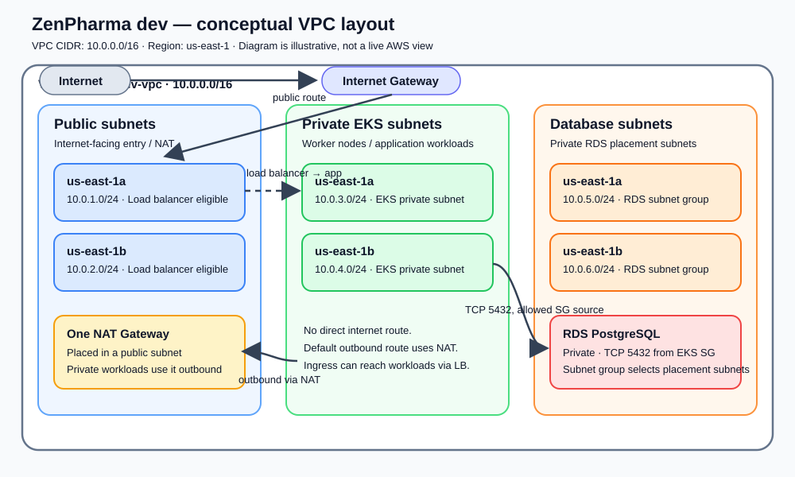

# VPC Architecture and Usage in This Project

## 1) What is a VPC?

A VPC (Virtual Private Cloud) is a logically isolated network inside AWS. It behaves like your own private network in the cloud, where you control:

- which IP ranges are used
- which resources are public or private
- how traffic flows between subnets
- who can access your workloads
- which services are reachable from the internet and which are not

In simple words, a VPC is the foundation of your cloud network. It lets you build a secure environment where public services (like a web app) can communicate with private services (like a database or Kubernetes nodes) without exposing everything to the internet.

### Why do we need a VPC?

A VPC is needed because real applications have different trust levels and access patterns:

- Public-facing services need internet access
- Databases should remain private
- Internal microservices should talk to each other without public exposure
- Security groups and route tables should tightly control communication
- Kubernetes clusters need reliable networking between worker nodes, services, and control plane

Without a VPC, resources would be difficult to isolate, hard to secure, and harder to manage as the platform grows.

---

## 2) VPC in this project

This repository creates a custom VPC for the ZenPharma platform using the Terraform AWS VPC module:

- module source: `terraform-aws-modules/vpc/aws`
- version: `~> 6.0`
- name: `${project}-${env}-vpc`
- CIDR: `10.0.0.0/16`

The actual VPC definition is in:

- [modules/vpc/main.tf](./main.tf)
- [modules/vpc/variables.tf](./variables.tf)
- [modules/vpc/outputs.tf](./outputs.tf)

The environment calls this module from:

- [envs/dev/main.tf](../../envs/dev/main.tf)

---

## 3) How the VPC is configured

The environment configures the VPC like this:

```hcl
module "vpc" {
  source = "../../modules/vpc"

  project               = local.project
  env                   = local.env
  region                = local.region
  vpc_cidr              = "10.0.0.0/16"
  public_subnet_cidrs   = ["10.0.1.0/24", "10.0.2.0/24"]
  private_subnet_cidrs  = ["10.0.3.0/24", "10.0.4.0/24"]
  database_subnet_cidrs = ["10.0.5.0/24", "10.0.6.0/24"]
}
```

This tells AWS to create:

- one VPC in the `10.0.0.0/16` range
- two public subnets
- two private subnets for EKS workers
- two database subnets for RDS
- one NAT gateway
- a database subnet group
- DNS support and DNS hostnames enabled

EKS workers run in private subnets so they are not directly reachable from the public internet, reducing their exposure to inbound threats. They can still make outbound connections through the NAT gateway when needed.

### The actual Terraform module contains:

```hcl
module "vpc" {
  source  = "terraform-aws-modules/vpc/aws"
  version = "~> 6.0"

  name = "${var.project}-${var.env}-vpc"
  cidr = var.vpc_cidr

  azs              = ["${var.region}a", "${var.region}b"]
  public_subnets   = var.public_subnet_cidrs
  private_subnets  = var.private_subnet_cidrs
  database_subnets = var.database_subnet_cidrs

  enable_nat_gateway           = true
  single_nat_gateway           = true
  enable_dns_hostnames         = true
  enable_dns_support           = true
  create_database_subnet_group = true

  public_subnet_tags = {
    "kubernetes.io/role/elb" = "1"
  }

  private_subnet_tags = {
    "kubernetes.io/role/internal-elb"                          = "1"
    "kubernetes.io/cluster/${var.project}-${var.env}-cluster"  = "owned"
  }
}
```

### What these settings mean

- `enable_nat_gateway = true`:
  tells the VPC module to create a NAT Gateway so resources in private subnets can start connections to the internet without being directly exposed.

  **Important:** the NAT Gateway is not placed inside a private subnet. It is placed in one of the public subnets so it can reach the Internet Gateway. Here, “the first public subnet” means the first item in the `public_subnet_cidrs` list in [envs/dev/main.tf](../../envs/dev/main.tf): `10.0.1.0/24`. The first Availability Zone in the VPC module's `azs` list is `us-east-1a`, so this subnet is in `us-east-1a`. Because `single_nat_gateway = true`, the module creates just one NAT Gateway, in that subnet; it does not create one in each of the two public subnets. The other public subnet is `10.0.2.0/24` in `us-east-1b`.

  **What this means, and where to verify it in AWS:** both private EKS subnets (`10.0.3.0/24` and `10.0.4.0/24`) are associated with a private route table. In the AWS Console, open **VPC → Route tables**, select the private route table, and open **Subnet associations**. Check that both EKS subnet CIDRs are listed there. Then open **Routes** for that same table and find the row whose destination is `0.0.0.0/0`. Its target should be the ID of the single NAT Gateway (shown as `nat-...`). To confirm which AZ contains that gateway, open **VPC → NAT Gateways**, select that `nat-...` ID, and check its subnet and Availability Zone; for this configuration, it is placed in the first public subnet, `10.0.1.0/24` in `us-east-1a`.

  **How to read what you see:** when a node in either associated private subnet sends traffic to an IPv4 address outside the VPC, the `0.0.0.0/0 → nat-...` row tells AWS to forward it to that NAT Gateway. Thus a node in `us-east-1b` uses the same NAT Gateway in `us-east-1a`; it does not get a separate gateway in its own AZ. The route table is the AWS Console evidence for this behavior—not a setting on the EKS node itself. This single-gateway choice lowers NAT Gateway costs, but traffic from the other AZ may cross AZ boundaries, and internet egress depends on the one gateway. AWS does not automatically fail over to a NAT Gateway in another AZ—none is configured here. For higher AZ-level availability, use one NAT Gateway per AZ and route each private subnet through the NAT Gateway in its own AZ, at higher cost.

  The module performs the setup behind the scenes:

  1. During `terraform apply`, the VPC module allocates an Elastic IP (EIP) for the NAT Gateway. AWS reserves this public IPv4 address for your account in the selected region; it is not the IP address of your computer. To find it after deployment, open **EC2 → Network & Security → Elastic IPs**. The **Public IPv4 address** is the address itself, and the **Allocation ID** identifies it in AWS. The NAT Gateway details also show the EIP attached to it.
     In this app, the NAT Gateway uses the EIP as the shared, stable public source address for internet-bound traffic from EKS worker nodes in private subnets, such as when they download container images or call external APIs.
  2. It creates the NAT Gateway in the first public subnet and attaches that Elastic IP.
  3. It creates/uses a public route table with a route to the Internet Gateway, so the NAT Gateway can reach the internet.
     The NAT Gateway sits in a public subnet but does not itself connect directly to the internet; the Internet Gateway is the VPC's link to the internet, and the public route table directs the NAT Gateway's outbound traffic through it. The full outbound path is private-subnet resource → NAT Gateway → Internet Gateway → internet; replies return through the NAT Gateway to the resource that started the connection. The Internet Gateway alone does not expose private-subnet resources to unsolicited inbound connections.
     In the AWS Console, open **VPC → Route tables → Routes** to inspect both default routes: the private route table sends `0.0.0.0/0` to the NAT Gateway, and the public route table sends `0.0.0.0/0` to the Internet Gateway. Check **VPC → Internet gateways** to confirm the gateway is attached to the VPC, and **VPC → NAT gateways** to see the NAT Gateway's public subnet and attached Elastic IP.
  4. It associates the private EKS subnets with a private route table. Because `single_nat_gateway = true`, they share one private route table.
  5. It explicitly adds a route to that private route table: destination `0.0.0.0/0` (all IPv4 destinations) → the NAT Gateway's AWS resource ID. The module's `create_private_nat_gateway_route` option defaults to `true`.

  **What does “private resources” mean here?** It means resources such as EKS worker nodes running in the private subnets (`10.0.3.0/24` and `10.0.4.0/24`). They use private IP addresses and are not directly exposed to the public internet. When one of them starts an internet connection, its traffic goes through the NAT Gateway.

  **What is the “outbound address”?** It is the public source IP address that an internet destination sees for a connection started by a private resource. For example, an EKS node might have private IP `10.0.3.25`. When it connects to an external service, the NAT Gateway sends the request using its EIP as the public source address (for illustration only, `203.0.113.10` is a documentation example, not your deployed address). The external service sees the NAT Gateway's EIP, not `10.0.3.25`. With the single NAT Gateway configured here, private-subnet internet connections share that NAT Gateway's EIP. The reply comes back to the EIP and the NAT Gateway forwards it to the node that started the connection. The EIP remains the same while it stays allocated and attached to this NAT Gateway; replacing or deleting those resources may result in a different address. If an external service requires an IP allowlist, you can give it this EIP. It does not let outside users start connections directly to the private node.

  **Verify these five steps in the AWS Console** (select `us-east-1` first):

  1. **Elastic IP:** open **EC2 → Network & Security → Elastic IPs**. Find the EIP by the allocation ID shown on the NAT Gateway details page. Confirm it is associated with the NAT Gateway. This is the NAT's stable public address.
     **Why it is under EC2:** Elastic IPs are public IP address resources managed by AWS's EC2 networking service. They can be associated with EC2 instances or other network resources, including a NAT Gateway. In this setup, the EIP is associated with the NAT Gateway so private-subnet traffic sent out through it has a stable public source address; it is not assigned to an EC2 worker.
  2. **NAT Gateway placement:** open **VPC → NAT Gateways** and select the NAT Gateway for `pharma-dev-vpc`. Confirm **State** is `Available`, **Connectivity type** is `Public`, **Subnet** is `10.0.1.0/24` (first public subnet), and its **Elastic IP** matches step 1.
  3. **Public route for NAT:** open **VPC → Route tables**. Find the route table associated with the public subnet from step 2. Under **Routes**, confirm `0.0.0.0/0` points to an Internet Gateway (`igw-...`). Under **Subnet associations**, confirm it is associated with that public subnet.
  4. **Private subnet association:** in **VPC → Route tables**, find the route table associated with the private EKS subnets (`10.0.3.0/24` and `10.0.4.0/24`). Under **Subnet associations**, confirm both private subnets use the private route table. Because `single_nat_gateway = true`, they share one private route table in this configuration.
  5. **Private default route to NAT:** on that same private route table, open **Routes**. Confirm `0.0.0.0/0` targets the NAT Gateway ID from step 2 (shown as `nat-...`). This is the explicit link that tells AWS to send unmatched outbound traffic from those private subnets to the NAT Gateway.

  **The traffic path, in plain language:** an EKS node in a private subnet sends a request to an internet destination. AWS checks the private subnet's route table, which sends internet-bound traffic (`0.0.0.0/0`) to the NAT Gateway. The NAT Gateway replaces the node's private source IP with its Elastic IP (EIP), then sends the request using the route from its public subnet through the Internet Gateway. The reply returns to the EIP; the NAT Gateway maps it back to the node that started the request. The EIP is the NAT Gateway's public address, not a separate routing device or hop.

  ```text
  Outbound request:
  EKS node (private subnet)
    -> private route table
    -> NAT Gateway (uses its EIP as the public source address)
    -> public route table
    -> Internet Gateway
    -> internet destination

  Reply:
  internet destination
    -> Internet Gateway
    -> NAT Gateway's EIP
    -> NAT Gateway
    -> EKS node that started the request
  ```

  If a route is missing or the NAT Gateway is not `Available`, private-subnet internet egress may not work. The console displays deployed state; Terraform configuration and plan describe what should be created.

  **How does the private route table know about the NAT Gateway?** It does not discover it automatically. The VPC module contains Terraform resource definitions that connect them: the route resource uses the private route table ID as its route table and the NAT Gateway ID as its target. Because this repository sets `enable_nat_gateway = true` and `single_nat_gateway = true`, and leaves `create_private_nat_gateway_route` at its default of `true`, Terraform creates both resources and the connecting route. AWS then stores that route in the route table.

  **What happens to a packet?** An EKS node sends traffic to an address outside the VPC. Its subnet is associated with the private route table. AWS checks the destination, finds the `0.0.0.0/0 → NAT Gateway` rule, and forwards the packet to that NAT Gateway. The NAT Gateway is in a public subnet; that subnet's route table has a route to the Internet Gateway, so the NAT Gateway can send the request out. The NAT Gateway tracks the outbound connection and allows the response back to the node.

  ```text
  Terraform module creates this rule:
  private route table: 0.0.0.0/0 -> nat-abc123 (NAT Gateway ID)

  Then AWS forwards traffic along the configured route:
  EKS node -> private route table -> NAT Gateway
            -> public route table -> Internet Gateway -> internet
  ```

  So **the route must exist**; AWS does not guess that private subnets should use NAT just because a NAT Gateway exists. In this project, the reusable VPC module creates the route for you from its internal Terraform code and defaults. You would only write a separate route resource yourself if you were not using this module or needed custom routing behavior.

  So when an EKS node needs to download something, the path is:

  ```text
  EKS node in private subnet
      -> private route table
      -> NAT Gateway in public subnet
      -> public route table
      -> Internet Gateway
      -> internet
  ```

  The NAT Gateway translates the node's private source address for outbound traffic. It allows responses for connections the private resource started to come back, but does not make that resource directly reachable from the internet. The NAT Gateway has an hourly and data-processing cost; using one saves cost compared with one per AZ, but means private-subnet internet egress depends on that single AZ's NAT Gateway.

- `single_nat_gateway = true`:
  tells the VPC module to create one NAT Gateway and use it for the private subnet groups, instead of creating a separate NAT Gateway for each Availability Zone. The module puts that gateway in the first public subnet (`10.0.1.0/24`, in `us-east-1a` in this configuration) and points the private route table at it.

  **Why choose one?** NAT Gateways have an hourly charge and a data-processing charge, so one is cheaper than one per AZ. The tradeoff is availability and cross-AZ traffic: if the AZ containing this single NAT Gateway has an outage, private subnets in both AZs may lose their NAT-based internet access; traffic from the other AZ may also cross AZ boundaries. For higher availability, production configurations commonly use one NAT Gateway per AZ, accepting the additional cost.

  **Example:** an EKS node in `us-east-1b` wants to download an update. Its private route table sends the request to the shared NAT Gateway in `us-east-1a`, which sends it out through the Internet Gateway. The node remains in its private subnet; only the outbound path uses the NAT Gateway.

  **In the AWS Console:** open **VPC → NAT Gateways** and expect one available NAT Gateway in a public subnet. Then open **VPC → Route tables**, choose the table associated with a private subnet, and check that its default route (`0.0.0.0/0`) targets that NAT Gateway.

- `enable_dns_hostnames = true`:
  enables AWS to assign DNS hostnames to instances in the VPC (for example, an EC2 instance's private DNS hostname, and public DNS hostname when it has a public IPv4 address). It does not itself perform DNS lookups; that is what `enable_dns_support` enables. For AWS features that depend on DNS names, such as private hosted-zone resolution, both DNS settings generally need to be enabled.

  **Example:** an EKS node or EC2 instance can be addressed by its AWS-provided hostname rather than requiring a human to look up and use its changing IP address. DNS hostnames are names associated with resources; enabling them does not make a private instance publicly reachable.

  **In the AWS Console:** open **VPC → Your VPCs**, select `pharma-dev-vpc`, and inspect **DNS hostnames** under the VPC details or **Actions → Edit VPC settings**. It should be enabled.

- `enable_dns_support = true`:
  enables DNS resolution through the Amazon-provided DNS resolver for this VPC. Resources can use DNS names (for example, AWS service endpoints and the RDS endpoint hostname) and have AWS resolve those names to IP addresses. It is not a route to the internet and does not by itself expose private resources.

  **Example:** an application connects to the RDS endpoint hostname stored in Secrets Manager. DNS support lets the EKS workload resolve that hostname to the database's private IP; the VPC local route carries traffic between the different subnets, and the RDS security group still decides whether PostgreSQL port `5432` is allowed.
  **Clarification:** Secrets Manager can store arbitrary secret values; in this configuration Terraform writes a JSON database-credentials secret whose `host` field comes from the RDS module's `db_instance_address` output, and the application must read that field and use it as the database hostname. To find the hostname in AWS, open **RDS → Databases → pharma-dev-postgres → Connection steps**; AWS manages the DNS record that resolves that endpoint to the database's current private IP, so no hostname-to-IP mapping is configured in Secrets Manager or this VPC module.

  **In the AWS Console:** on the same VPC details/settings page, inspect **DNS resolution** (sometimes shown as **DNS support**). It should be enabled. To work with AWS DNS hostnames and private hosted zones as expected, keep DNS resolution and DNS hostnames enabled together.

- `create_database_subnet_group = true`:
  creates a subnet group specifically for RDS so the database can be placed in private subnets.
  This does not create additional subnets. The `database_subnet_cidrs` input creates the database subnets; this setting groups those subnets into an AWS DB subnet group that RDS requires when selecting where to place the database. The VPC module exposes the group's name as `database_subnet_group_name`, which `envs/dev/main.tf` passes to the RDS module as `db_subnet_group_name`.
  **To verify it in AWS:** open **RDS → Subnet groups** in `us-east-1` and select `pharma-dev-vpc` (the dev group's name). Confirm the details show VPC `pharma-dev-vpc` and database subnets `10.0.5.0/24` and `10.0.6.0/24` in separate Availability Zones. AWS shows the actual subnet group resource here; `database_subnet_group_name` is the Terraform output/reference that passes its name to the RDS module.
  **Why pass the name to the RDS module?** The VPC module creates the RDS DB subnet group and exports its name as a Terraform output; `envs/dev/main.tf` passes that output to the RDS module, which supplies it to AWS when creating the database so RDS knows which subnets it may use. The subnet group is an RDS resource shown under **RDS → Subnet groups** in the console, even though the VPC module creates it.

- `public_subnet_tags` and `private_subnet_tags`:
  these are important for Kubernetes and AWS Load Balancer integration, so EKS and ELB can discover the correct subnets.
  **Why these values?** They are standard subnet-discovery markers used by the AWS Load Balancer Controller and related Kubernetes AWS integrations, not values AWS invents automatically. When Kubernetes requests a load balancer, the controller can inspect subnet tags to find candidate subnets of the requested type. `kubernetes.io/role/elb = "1"` is a marker that says "this subnet is eligible for an internet-facing load balancer"; `kubernetes.io/role/internal-elb = "1"` similarly marks a candidate for an internal load balancer. The value `"1"` is a conventional tag value the controller recognizes—it is not a count, a switch that creates a load balancer, or an instruction to route traffic. The private-subnet key `kubernetes.io/cluster/${var.project}-${var.env}-cluster = "owned"` expands in dev to `kubernetes.io/cluster/pharma-dev-cluster = "owned"` and marks the subnet as associated with this EKS cluster for integrations that use cluster tags during discovery.
  **Where to verify in AWS:** open **VPC → Subnets**, select a public or private subnet, and inspect its **Tags** tab. Look for `kubernetes.io/role/elb` on public subnets, and `kubernetes.io/role/internal-elb` plus `kubernetes.io/cluster/pharma-dev-cluster` on private subnets. Tags label subnets for discovery; they do not make a subnet public or private by themselves—routing and route-table associations determine that.

---

## Route tables, simply explained

Imagine each subnet is a neighborhood, and a route table is the sign at the neighborhood exit. When a computer in that subnet wants to send something, the sign tells AWS which way to send it.

The sign does not list every computer or every website. It uses broad destination ranges:

- **“This destination is inside our VPC”** → keep the traffic inside the VPC.
- **“This is somewhere else”** → use the subnet's default exit, such as the Internet Gateway or NAT Gateway.

In route-table terms, a rule has two parts:

```text
Destination (where traffic wants to go)  ->  Target (next way out)
```

### How AWS picks a route

AWS looks at the **destination address** of the traffic and checks the route table associated with the sender's subnet. It picks the most specific matching destination.

For example, `10.0.0.0/16` means “addresses inside this VPC,” while `0.0.0.0/0` means “any IPv4 address.” If traffic is going to another machine in this VPC, the `10.0.0.0/16` rule is a better match than the broad `0.0.0.0/0` rule, so AWS keeps that traffic inside the VPC.

You do not write these route rules in this repository. Your code calls the VPC module, and that module creates the route tables, rules, and subnet associations using your settings and its defaults.

### The three subnet groups in this project

Your dev environment defines six subnets in [envs/dev/main.tf](../../envs/dev/main.tf). Think of them as neighborhoods with different purposes:

| Subnet group | CIDRs | Simple purpose |
|---|---|---|
| Public | `10.0.1.0/24`, `10.0.2.0/24` | Places for internet-facing entry points, such as load balancers. |
| Private EKS | `10.0.3.0/24`, `10.0.4.0/24` | Places where the Kubernetes worker nodes run. |
| Database | `10.0.5.0/24`, `10.0.6.0/24` | Places RDS can choose from to run the database. |

The module connects those groups to route tables. In simple terms, it builds these paths:

```text
Public subnet:
  inside this VPC  -> stay inside VPC
  outside this VPC -> Internet Gateway -> internet

Private EKS subnet:
  inside this VPC  -> stay inside VPC
  outside this VPC -> NAT Gateway -> Internet Gateway -> internet

Database subnet (this configuration's module default):
  uses the private route table unless a separate database route table is enabled
```

The public route table is the neighborhood exit directly to the Internet Gateway. The private route table's exit goes first to the NAT Gateway. The NAT Gateway lets private resources start outbound connections without giving them direct public addresses.

Because `single_nat_gateway = true`, the module uses one shared NAT Gateway for the private subnets. It also uses one shared private route table for those subnets.

### What happens in real examples?

**Example 1: An EKS node connects to PostgreSQL**

1. The EKS node is in one subnet, for example `10.0.3.0/24`; RDS is in a different subnet, for example `10.0.5.0/24`.
2. Those are separate subnet ranges, but both are inside the larger VPC range `10.0.0.0/16`. That is what “same VPC” means: same overall private network, not the same subnet.
3. The route table has a built-in `10.0.0.0/16 → local` route. It keeps traffic between subnets in this VPC on the private AWS network; it does not send it to the internet or NAT.
4. The RDS security group then checks whether the connection from the EKS node is allowed on PostgreSQL port `5432`. The route chooses the path; the security group decides whether the connection is allowed.

**Example 2: An EKS node downloads something from the internet**

1. The destination is not inside the VPC.
2. The private route table sends the traffic to the NAT Gateway.
3. NAT sends it out through the Internet Gateway.
4. The response comes back through NAT to the node. The node itself has not been made directly reachable from the internet.

**Example 3: A user visits the application**

1. The public load balancer is in a public subnet.
2. The public route table provides a path through the Internet Gateway.
3. The load balancer's listener and security rules must also allow the request; the route alone does not authorize it.

RDS is not made public just because database subnets use the private route table. In this project the RDS module sets `publicly_accessible = false`, and its security group allows PostgreSQL traffic only from the EKS node security group.

### One important difference: database subnet group vs route table

`database_subnet_cidrs` creates the database subnet neighborhoods. `create_database_subnet_group = true` groups those subnets so RDS knows where it may place the database. It does **not** create a route table.

The upstream dependency `terraform-aws-modules/vpc/aws` has an input named `create_database_subnet_route_table`. It is not set in this repository's Terraform code: [modules/vpc/main.tf](./main.tf) calls the upstream module with version constraint `~> 6.0` but does not pass this input. In the upstream module source currently downloaded by Terraform, the input's default is `false`, which means the module does not create a separate route table for the database subnets and instead associates them with the private route table. This behavior comes from the dependency's default, not a hardcoded setting in this repository; changing the dependency version could change its implementation or default. Separately, [envs/dev/main.tf](../../envs/dev/main.tf) passes the VPC module's database subnet group name to the RDS module so RDS can place the database in those subnets.

### Where to see it in AWS Console

Open **VPC → Route tables**:

1. Select a route table and open **Subnet associations**. This shows which subnet neighborhoods use that table.
2. Open **Routes**. Read each row as “destination → next hop.”
3. Look for `10.0.0.0/16 → local` for traffic that stays in the VPC.
4. In a public table, look for `0.0.0.0/0 → igw-...`.
5. In the private table, look for `0.0.0.0/0 → nat-...`.

The AWS Console shows the actual deployed routes. Names, IDs, or associations can differ if the configuration or module defaults have changed. Avoid making manual console edits to Terraform-managed route tables; change the Terraform configuration and review the plan instead.

---

## Verify the VPC in the AWS Console

After Terraform has successfully applied, sign in to the AWS Console and select the configured region, `US East (N. Virginia) / us-east-1`. The console shows the deployed state; Terraform files show the intended configuration. Compare both when troubleshooting.

The region selector shows `us-east-1`; it does not show individual Availability Zones such as `us-east-1a` or `us-east-1b`. To see the zones used by this VPC, open **VPC → Subnets**, filter for `pharma-dev-vpc`, and look at the **Availability Zone** column. Match each subnet's CIDR (for example, `10.0.1.0/24`) with the zone shown in that row. You can also open a subnet and check its details.

**Note:** AWS Availability Zone letters (`a`, `b`, and so on) are mapped per AWS account. Therefore, `us-east-1a` in one account may be a different physical AZ from `us-east-1a` in another account. For this VPC, verify the subnet-to-AZ mapping in the same AWS account where Terraform deployed it. The Terraform configuration assigns the first listed subnet CIDR to the first AZ in its `azs` list and the second CIDR to the second AZ.

The diagram below is a conceptual view of the subnet layout and traffic paths. It is not a live screenshot, and AWS may assign different resource IDs and names.



### Console checks for this module

| Terraform configuration | AWS Console location | What to verify |
|---|---|---|
| `name` and `cidr` | **VPC** → **Your VPCs** → select `pharma-dev-vpc` | The VPC IPv4 CIDR is `10.0.0.0/16`. Check the **Details** tab for DNS support and DNS hostnames. |
| `azs`, `public_subnets`, `private_subnets`, `database_subnets` | **VPC** → **Subnets** → filter by the VPC | There should be six subnets: two per tier, with the configured CIDRs and Availability Zones. Select a subnet to inspect its CIDR, AZ, VPC, and tags. |
| Public subnet routing | **VPC** → **Route tables** → select the route table associated with a public subnet | Its routes should include the VPC's local route and `0.0.0.0/0` to an Internet Gateway (`igw-...`). The route, not just the subnet tag, is what makes it public. |
| Private EKS subnet routing | **VPC** → **Route tables** → select the route table associated with a private subnet | Inspect the default route. With NAT enabled, private-subnet outbound internet traffic should route through a NAT Gateway (`nat-...`); there should not be a default route directly to an Internet Gateway. |
| Database subnet routing | **VPC** → **Route tables** → select the route table associated with each database subnet | Verify the actual routes and associations. The CIDRs and the DB subnet group do not by themselves define internet reachability; routing and security groups also matter. |
| `enable_nat_gateway = true`, `single_nat_gateway = true` | **VPC** → **NAT Gateways** | Confirm a NAT Gateway exists, is **Available**, and is in a public subnet. This setting requests one shared NAT Gateway, not one per AZ. |
| Internet Gateway (created by the VPC module) | **VPC** → **Internet gateways** | Confirm an Internet Gateway is attached to `pharma-dev-vpc`, and that public route tables point their default route to it. |
| `enable_dns_support`, `enable_dns_hostnames` | **VPC** → **Your VPCs** → select the VPC → **Actions** → **Edit VPC settings** (or **Details**) | Confirm both DNS resolution and DNS hostnames are enabled. AWS Console labels can vary slightly. |
| `create_database_subnet_group = true` | **RDS** → **Subnet groups** → select the group referenced by Terraform | Confirm it belongs to this VPC and includes the two database subnets in separate AZs. This is an RDS placement group; it does not create the subnets. |
| `public_subnet_tags`, `private_subnet_tags` | **VPC** → **Subnets** → select a subnet → **Tags** | Public subnets should have `kubernetes.io/role/elb = 1`. Private subnets should have `kubernetes.io/role/internal-elb = 1` and the EKS cluster ownership tag. These tags help AWS load-balancer integration discover eligible subnets; tags do not change routing. |

> **Tip:** In the **Route tables** page, select a route table and inspect both **Routes** and **Subnet associations**. A subnet's role is determined by its associated route table and routes, not by its name or tags alone.

### Verify the NAT Gateway and its Elastic IP

To follow the outbound path in the AWS Console, use the same region (`us-east-1`) and:

1. Open **VPC → NAT Gateways** and select the NAT Gateway belonging to `pharma-dev-vpc`. Confirm its state is **Available**, its connectivity type is **Public**, and its subnet is the public subnet (`10.0.1.0/24` in the first configured AZ for this setup).
2. In the NAT Gateway details, note its **Public IPv4 address** and **Elastic IP allocation ID**. This is the public address internet destinations see for connections routed through this NAT Gateway.
3. Open **EC2 → Network & Security → Elastic IPs**. Find that public IPv4 address or allocation ID and confirm it is associated with the NAT Gateway. This verifies the EIP belongs to the NAT Gateway, not to an EKS node.
4. Open **VPC → Route tables**. Select the route table associated with a private EKS subnet and open **Routes**. Confirm the `0.0.0.0/0` route target is the NAT Gateway ID from step 1.
5. Select the public route table and confirm it is associated with the public subnet containing the NAT Gateway and has `0.0.0.0/0` pointing to the VPC's Internet Gateway.

Together, these checks show the links: **private subnet → private route table → NAT Gateway → EIP → public subnet route table → Internet Gateway**. The EIP alone does not prove that private workloads use it; the private route-table target and public route to the Internet Gateway complete the path.

To verify the *observed* outbound IP from an actual private workload, an authorized operator can make an outbound request from that workload to an approved external IP-check service and compare the reported public IPv4 address with the NAT Gateway's EIP. This test requires outbound connectivity and should not be run from a workload unless permitted by project policy. Do not expose credentials, secret values, or sensitive application data in the request.

### Verify the database subnet group end to end

1. In **VPC** → **Subnets**, filter by `pharma-dev-vpc` and confirm `10.0.5.0/24` and `10.0.6.0/24` exist in the expected AZs.
2. In **RDS** → **Subnet groups**, open the group whose name Terraform exports as `database_subnet_group_name`.
3. Confirm the group lists those database subnets and the correct VPC.
4. In **RDS** → **Databases**, open the PostgreSQL instance and confirm its **Connectivity & security** section references that VPC/subnet group and shows **Publicly accessible: No**.
5. In **EC2** → **Security Groups**, inspect the RDS security group. Its PostgreSQL ingress should use TCP port `5432` and the EKS node security group as the source.

This follows the Terraform wiring: the VPC module exports `database_subnet_group_name`, [envs/dev/main.tf](../../envs/dev/main.tf) passes it to the RDS module, and [modules/rds/main.tf](../rds/main.tf) sets `publicly_accessible = false` and configures the database security group.

### What to do if a console value differs

- Make sure the console is set to `us-east-1` and the selected VPC is the `pharma-dev-vpc` for the right AWS account.
- Compare the resource against Terraform configuration and state; console edits made manually may be overwritten by a later Terraform apply.
- Do not change production or shared resources from the console as a shortcut. Make the intended change in Terraform, review the plan, and apply it through the project's approved workflow.

---

## 4) Network layout in this repo

The VPC is split into three logical networking zones:

### 4.1 Public subnets

```text
10.0.1.0/24  -> us-east-1a
10.0.2.0/24  -> us-east-1b
```

These are used for resources that need internet access directly, such as:

- public load balancers
- ingress traffic
- NAT gateway public side

In this project, these subnets support internet-facing entry points for the application.

### 4.2 Private EKS subnets

```text
10.0.3.0/24 -> us-east-1a
10.0.4.0/24 -> us-east-1b
```

These are used for the Kubernetes worker nodes and internal services.

This is important because:

- Kubernetes nodes do not need public IPs
- backend services stay private
- only load balancers expose app traffic to the outside
- the cluster can still reach AWS APIs securely and privately

The EKS module is configured like this:

```hcl
module "eks" {
  source = "../../modules/eks"

  vpc_id     = module.vpc.vpc_id
  subnet_ids = module.vpc.private_subnets
}
```

So the EKS control plane and nodes are placed inside the VPC private networking.

### 4.3 Database subnets

```text
10.0.5.0/24 -> us-east-1a
10.0.6.0/24 -> us-east-1b
```

These are used for the PostgreSQL database.

RDS is configured with:

```hcl
db_subnet_group_name = module.vpc.database_subnet_group_name
vpc_id = module.vpc.vpc_id
```

This means the database is not internet-accessible and is placed in private subnets. Only allowed traffic from the EKS security group reaches PostgreSQL on port 5432.

---

## 5) Why this subnet design matters

This project follows a very common AWS pattern:

- Public subnet = internet-facing entry point
- Private subnet = internal application layer
- Database subnet = sensitive data layer with limited access

This design creates a layered security model.

Example:

- users access the application's UI through a public load balancer
- the application runs inside EKS in private subnets
- the database stays in private database subnets
- only EKS worker nodes can reach the DB
- the internet cannot directly reach the database

This is exactly the reason VPCs are used in production workloads.

---

## 6) How the VPC connects with the rest of the infra

The VPC is not a standalone feature here; it acts as the network foundation for all other services.

### 6.1 EKS depends on the VPC

In [envs/dev/main.tf](../../envs/dev/main.tf), the VPC output values are passed into the EKS module:

```hcl
module "eks" {
  vpc_id     = module.vpc.vpc_id
  subnet_ids = module.vpc.private_subnets
}
```

This means the Kubernetes cluster is launched inside the VPC and uses the private subnet group.

### 6.2 RDS depends on the VPC

RDS is also placed inside the VPC and uses the database subnet group:

```hcl
module "rds" {
  vpc_id                     = module.vpc.vpc_id
  db_subnet_group_name       = module.vpc.database_subnet_group_name
  eks_node_security_group_id = module.eks.node_security_group_id
}
```

The security group for RDS allows inbound traffic only from the EKS node security group on port 5432.

This is important because:

- database is private
- application can access it
- direct internet access is blocked
- attack surface is reduced

### 6.3 IAM and Kubernetes IRSA also rely on the cluster inside the VPC

The IAM module uses the EKS OIDC provider to grant AWS permissions to Kubernetes pods without long-lived credentials. The cluster itself has to exist inside the VPC to participate in AWS networking and service discovery.

This is part of the same cloud architecture: networking, identity, and security are connected.

---

## 7) What is the real use of each VPC resource here?

### Public subnets
Use case:

- internet-facing ALB/NLB
- front-end application access
- ingress traffic from outside

Need:

- users must reach the UI
- the app needs public connectivity

### Private subnets
Use case:

- EKS nodes
- application microservices
- internal API components

Need:

- keep app workloads isolated
- avoid direct internet exposure
- allow internal-only communication

### Database subnets
Use case:

- RDS PostgreSQL
- private storage layer

Need:

- protect sensitive data
- reduce exposure to public traffic
- restrict access to trusted internal services only

### NAT Gateway
Use case:

- private workloads need to reach the internet for package upgrades or outbound network access

Need:

- EKS nodes can pull container images or packages without public IPs
- private resources maintain outbound internet connectivity

### Route tables and AWS routing
Use case:

- route public traffic to the Internet Gateway
- route private traffic to the NAT Gateway
- isolate internal network flows

Need:

- proper path selection between subnets and public/private traffic
- secure, deterministic traffic flow

---

## 8) When is VPC needed in a real project?

A VPC is needed in these situations:

### Scenario 1: Public web application with a private database

A company hosts a pharmacy portal. The frontend is public; the database must stay private.

- Frontend in public subnet
- Application server in private subnet
- Database in private database subnet
- NAT allows outbound traffic
- Internet Gateway handles public traffic

This is almost the exact pattern used in this repo.

### Scenario 2: Kubernetes environment

A platform is running microservices in EKS.

- worker nodes are private
- pods communicate inside the cluster
- load balancers expose public endpoints
- AWS services like RDS and Secrets Manager are accessed privately

The VPC ensures cluster networking is secure and isolated.

### Scenario 3: Multi-tier architecture

A business needs separate layers:

- internet layer
- application layer
- security layer
- database layer

A VPC gives clean separation and makes it easier to apply security groups and subnets per layer.

### Scenario 4: Secure compliance workloads

Government or healthcare workloads often require strict isolation, private networking, and controlled external access. VPCs help meet those requirements with private connectivity and segmentation.

---

## 9) Real-world example for this project

Imagine ZenPharma is a digital pharmacy platform with:

- a public React UI for customers and staff
- an API gateway and microservices in Kubernetes
- a PostgreSQL database storing patient and order data
- secrets stored in AWS Secrets Manager

In this environment:

- Users hit the website through a public-facing ingress endpoint.
- The frontend and API services run inside EKS private nodes.
- The PostgreSQL database lives in private database subnets.
- Traffic from the internet reaches only the public application layer.
- Database access is limited to the EKS security group.
- NAT allows private workloads to send outbound traffic securely.

So the VPC is the boundary that protects internal systems while still allowing users and clients to access the public app.

This is exactly why the VPC module is one of the most important pieces in the infrastructure code.

---

## 10) What happens if the VPC is not designed correctly?

If the network is misconfigured, several issues can happen:

- public services exposed unintentionally
- database reachable from the internet
- traffic blocked between app layers
- Kubernetes nodes unable to communicate with AWS services
- failed NAT or egress connectivity
- security incidents due to overexposed resources

That is why the VPC layout and subnet segmentation are crucial in any production AWS platform.

---

## 11) Important takeaway for this repository

The VPC in this project is not just a network container; it is the core infrastructure layer that enables the whole platform:

- EKS runs in private subnets
- RDS is isolated in database subnets
- public internet traffic is separated from private workloads
- AWS services are reached securely
- security boundaries are enforced

The code proves this by wiring VPC outputs directly into EKS and RDS modules.

In other words, the VPC is the networking backbone of the ZenPharma infrastructure, and the rest of the system depends on it.

---

## Key technical terms explained

### Subnet
A subnet is a smaller network range inside a VPC. It helps divide the VPC into logical sections, such as public, private, or database subnets. In this project, subnets are split by purpose, not just by region, so the platform has better security and traffic control.

### How a VPC and its subnets relate
A VPC is the larger private network, and its subnets are smaller address ranges inside that network. Two resources can be in **different subnets but still in the same VPC**. In this project, an EKS node may use `10.0.3.0/24` and RDS may use `10.0.5.0/24`; both ranges are contained within the VPC's `10.0.0.0/16` range. So “same VPC” means they share the same overall network boundary, not that they occupy the same subnet. The VPC's local route lets traffic travel between its subnets privately, while security groups still decide whether a particular connection is allowed.

### Public subnet
A public subnet is connected to an Internet Gateway and can accept inbound traffic from the internet. It is used for resources that must be reachable externally, such as public-facing load balancers or entry points.

### Private subnet
A private subnet does not have direct internet access. It is used for internal resources such as Kubernetes worker nodes and application services that should stay isolated from the public internet.

### Database subnet
A database subnet is a private subnet specifically reserved for databases like RDS. It limits direct access and reduces exposure to sensitive data.

### NAT Gateway
A NAT Gateway allows private resources in the VPC to reach the internet for outbound traffic without exposing those resources directly to inbound public traffic. This is especially useful for EKS nodes that need to pull packages or communicate outbound.

### Internet Gateway
An Internet Gateway is the VPC component that allows public traffic to reach internet-facing resources. It connects the VPC to the public internet.

### CIDR block
A CIDR block is the IP address range assigned to a VPC or subnet. Example: `10.0.0.0/16` means the VPC owns the IP range from `10.0.0.0` to `10.0.255.255`.

### Route table
A route table tells AWS how packets should flow inside the VPC and to the outside world. It decides whether traffic goes to the Internet Gateway, NAT Gateway, or another internal target.

### Security group
A security group is a virtual firewall. It controls which traffic is allowed to reach AWS resources. In this repo, the RDS security group allows access only from the EKS node security group on port 5432.

### Availability Zone (AZ)
An AWS Availability Zone is one isolated location inside a region. This project spreads resources across `us-east-1a` and `us-east-1b` to improve reliability.

### VPC endpoint vs public access
A VPC does not automatically expose resources publicly. In this project, services are intentionally placed in private subnets and only selected traffic is permitted, which reduces attack surface.

---

## 12) Summary

A VPC is required because cloud applications need network isolation, security, segmentation, and controlled traffic flow.

In this repo, the VPC is configured as:

- `10.0.0.0/16` overall network
- `10.0.1.0/24` and `10.0.2.0/24` public subnets
- `10.0.3.0/24` and `10.0.4.0/24` private EKS subnets
- `10.0.5.0/24` and `10.0.6.0/24` private database subnets
- NAT gateway for private workloads
- DNS enabled for private routing

This pattern is used for a real-world AWS setup where internet-facing services are separated from private data and worker resources. It is a standard and recommended architecture for secure Kubernetes and database workloads.
